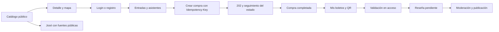

# Backend disponible y funcionamiento de la aplicación web

Análisis del cierre de Fase 9 basado en controllers, handlers, permisos y Swagger de la API compilada: **80 operaciones REST**, diez públicas y setenta con autenticación. El [inventario completo](ENDPOINTS.md) incluye método, ruta, acceso y descripción. Las rutas técnicas /health/live, /health/ready y /swagger son adicionales.

El backend está preparado para integrar catálogo, identidad, recintos, ventas simuladas, boletos, cuentas, reseñas y agente público con RAG. Este documento propone pantallas y flujos; no crea un frontend ni decide framework. D-09 permanece pendiente. A petición del usuario, reportes/exportaciones y Power BI se revisarán después; no se presentan como implementados.

## Organización de la aplicación

| Área de la web | Usuario | Qué muestra / hace | API principal |
|---|---|---|---|
| Inicio / catálogo | Visitante | Eventos públicos, filtros, fechas, recinto | GET /catalogo/eventos |
| Detalle de evento | Visitante | Categoría, presentadores, precios, cupos actuales y reseñas aprobadas | GET /catalogo/eventos/{id}, GET /eventos/{id}/resenas |
| Mapa del recinto | Visitante | Plano y polígonos de localidades; selección por área | GET /recintos/{id}/mapa?eventoId=… |
| Registro / login | Visitante | Alta de CLIENTE, autenticación y primer cambio obligatorio | /auth y PUT /usuarios/{id}/password |
| Perfil | Sesión completa | Datos propios y cambio de contraseña | GET/PUT /usuarios/{id} |
| Compra / seguimiento | CLIENTE | Entradas de un evento, asistentes cuando corresponde, importes del servidor y estado | POST /compras, GET /compras/{publicId} |
| Mis compras | CLIENTE | Historial propio y cancelación solo pendiente | GET /compras, POST /compras/{publicId}/cancelar |
| Mis boletos | CLIENTE | Boletos y QR, estados válido/usado/anulado | GET /boletos |
| Mis reseñas | CLIENTE | Crear tras asistir, editar y retirar | POST /resenas, GET /resenas/mis, PUT /resenas/{id}, POST …/retirar |
| Recintos y localidades | DUENO_RECINTO / ADMINISTRADOR | Gestión de recintos propios o todos según rol; geometría y plano | /recintos, /recintos/{id}/localidades, carga de imagen |
| Eventos y entradas | DUENO_RECINTO / ADMINISTRADOR | Borradores, presentadores, cupos, venta y estado | /eventos, /eventos/{id}/tipos-entrada, /eventos/{id}/presentadores |
| Validación de ingreso | DUENO_RECINTO / ADMINISTRADOR | Escáner o entrada de QR; resultado de validación única | POST /boletos/validar |
| Cuentas | DUENO_RECINTO / ADMINISTRADOR | Saldo y extractos propios/todos; administración de cierre/liquidación | /cuentas y /cuentas/{id}/movimientos |
| Usuarios y catálogos | ADMINISTRADOR | Altas privilegiadas, usuarios, categorías y presentadores | /usuarios, /categorias, /presentadores |
| Moderación | ADMINISTRADOR | Cola pendiente y decisión aprobar/rechazar | GET /resenas, PATCH /resenas/{id}/moderar |
| Documentos de José | ADMINISTRADOR | Subir, revisar texto, versionar, indexar y desactivar | /ia/documentos |
| Chat José | Visitante o usuario | Preguntas públicas y citas expandibles | POST /ia/consultas |
| Reportes / Power BI | Pendiente | No añadir botones que aparenten exportación funcional | Fase 10 pendiente |

Todas las rutas de la tabla tienen prefijo /api/v1. Las categorías/presentadores de administración se leen con sesión completa y solo ADMINISTRADOR los modifica. En pantallas públicas usa los datos de categoría/presentadores incluidos en el catálogo de eventos; no llames a endpoints privados para poblar esos elementos.

El rol determina navegación, pero no reemplaza la autorización del servidor. Un dueño solo puede gestionar sus recursos; un cliente solo sus compras, boletos y reseñas. Algunos recursos ajenos devuelven 404 deliberadamente. La alta de administradores tiene restricciones de nivel de acceso; no mostrarla como facultad universal de cualquier cuenta administrativa.

## Recorrido principal



### Sesión y permisos

El login devuelve accessToken, refreshToken nullable, expiraEn, debeCambiarPassword y usuarioId. El JWT contiene role y sub; los datos de usuario también exponen rol como string. Si debeCambiarPassword es true, dirige al cambio obligatorio; la sesión limitada no habilita paneles privados. Después del cambio hay que volver a iniciar sesión.

Centraliza el cliente HTTP y envía Authorization: Bearer cuando corresponda. El refresh rota el token: sincroniza su renovación para que dos pestañas/peticiones no reutilicen un refresh ya revocado. Al cambiar correo/contraseña o cerrar sesión se revocan accesos según el contrato. Un 401 debe provocar renovación válida o regreso al login, evitando bucles de reintentos.

La API actual devuelve tokens JSON, no una cookie HttpOnly automática. El almacenamiento y la coordinación entre pestañas deben definirse al crear el frontend; no supongas un flujo de cookies que la API no implementa. No registres tokens ni QRs en consola o analítica.

### Catálogo y mapa

El listado público incluye eventos PROGRAMADO, EN_VENTA y AGOTADO con recinto/categoría activos. Usa el estado y las ventanas de venta para habilitar la compra; que un evento aparezca en el catálogo no implica que se pueda comprar en ese instante. El agente estructurado consulta una selección más estricta de eventos EN_VENTA futuros con venta vigente.

El mapa usa imagenPlanoUrl y localidades.geometria. Dibuja polígonos sobre el plano manteniendo la misma referencia de coordenadas que usa el editor administrativo. D-08 ahora permite áreas generales y numeradas por evento. Para tipos numerada=true consulta la distribución pública paginada, permite selección de silla o mesa completa y envía asientoIds; las coordenadas de posiciones son normalizadas 0..1. No deduzcas disponibilidad a partir de una página incompleta. Contrato y flujo de actualización en [GUIA_NUMERACION.md](GUIA_NUMERACION.md). Con eventoId, el mapa incluye inventario de sus entradas; sin ese parámetro, cupoDisponible puede ser null. Un cupo mostrado es informativo: el servidor puede rechazar la reserva si otro cliente lo agotó.

### Compra asíncrona

Cada intención de compra genera una Idempotency-Key estable. Deshabilitar doble clic ayuda a la experiencia, pero el servidor garantiza la idempotencia. Si una solicitud pierde conexión, consulta o reintenta con la misma clave; crear una nueva puede iniciar otra compra.

Envía eventoId e items; asistentes son obligatorios en carreras. No codifiques el ID 5 de la categoría Carrera como regla universal: el backend lo configura por entorno. Acordar ese valor público con la configuración del frontend forma parte de la integración; el servidor siempre valida los requisitos.

El servidor devuelve los importes congelados: subtotal, comisión, IVA y total. El frontend puede anticipar una estimación, pero debe mostrar y respetar los montos del servidor. No pidas tarjetas reales: la pasarela disponible es simulada.

Con 202 conserva publicId y consulta GET /compras/{publicId}. Usa polling con espera moderada y backoff, cancélalo al salir de pantalla o al llegar a estado final. No muestres éxito antes de COMPLETADA. Atiende también respuesta 200 si el caso de uso devuelve una compra existente/final. Expira/cancela/falla devuelve cupo exactamente una vez; el cliente no calcula ni ejecuta esa devolución.

Cancelar solo procede desde PENDIENTE; PROCESANDO produce 409. Los reembolsos son administrativos y totales; una compra puede permanecer COMPLETADA mientras el pago esté REEMBOLSADO. No deduzcas el estado financiero únicamente del estado de compra ni ofrezcas reembolso parcial. El reembolso/liquidación actuales son registros contables simulados.

Para probar compras desde la web es necesario ejecutar el Worker y habilitar explícitamente sus opciones Outbox, Compras.Consumer, Notificaciones, Expiracion y Recuperacion según la guía de mensajería. Durante trabajo de IA se dejaron desactivadas en el entorno local: IA no requiere activar pagos ni consumidores. La entrega de IA no los activa automáticamente. Revisa los nombres exactos usados en tu configuración: Outbox__Enabled, Compras__ConsumerEnabled, Notificaciones__Enabled, Expiracion__Enabled, Recuperacion__Enabled. Si están false en .env, cambia conscientemente esos flags antes de probar ventas y arranca Worker con Start-Local -Servicio Worker.

### Boletos y reseñas

El frontend genera la imagen QR a partir de codigoQr tal como llega, sin alterar el token. Validar boleto solo está disponible para dueño autorizado o administrador. Un 409 en validación indica que no debe admitirse una segunda entrada; no lo trates como éxito por reintento.

La reseña requiere un boleto USADO del evento. Editarla la devuelve a PENDIENTE; retirarla conserva historial como RECHAZADA. La interfaz debe enviar estadoEsperado cuando lo exige el contrato y refrescar tras 409. El promedio por presentador considera únicamente reseñas aprobadas de sus eventos.

### Chat y administración de RAG

El chat no necesita login y nunca recibe las claves cloud desde el navegador. Conserva sessionId para agrupar mensajes visualmente, pero envía preguntas autocontenidas porque el servidor no reconstruye un historial privado. Muestra texto y fuentes como contenido inerte, con extractos expandibles, sin renderizar HTML arbitrario. No ofrezcas acciones personales ejecutadas por José.

El panel documental solo es de administrador: cargar no indexa; se ejecuta reindexar una vez por documento y se muestra INDEXADO/ERROR. Una nueva versión tiene ID nuevo. Al publicarse se retira la anterior; fallar una reindexación conserva el índice publicado. Los detalles y errores de chat están en [IA_RAG.md](IA_RAG.md).

## Contratos comunes del cliente HTTP

- Base URL por entorno, JSON camelCase y fechas UTC. Convertir a zona del usuario solo para mostrar; enviar rangos UTC donde lo pide la API.
- Listados con page/pageSize y total. Hay DTOs de página de varios módulos: usa los esquemas de Swagger, sin asumir un único envoltorio para respuestas que no son listados.
- Estados vacíos/cargando/error visibles; validación 400 por campo; 401 sesión, 403 permiso, 404 inexistente/ajeno, 409 conflicto y refresco, 422 regla de negocio/proveedor, 429 espera manual.
- Usar ProblemDetails, sus codes y traceId; no mostrar stack traces. Evitar reintentos automáticos de operaciones con efecto o consumo cloud.
- Imágenes y documentos usan FormData. Deja que el navegador genere Content-Type con boundary.
- CORS exige el origen explícito del frontend. Ejemplo local, ajustando tu puerto real:

```powershell
dotnet user-secrets set "Cors:AllowedOrigins:0" "http://localhost:5173" --project src/Promotora.WebApi
```

Reinicia la API después de configurarlo. El puerto 5173 es un ejemplo de desarrollo, no una decisión de framework. CORS permite GET/POST/PUT/PATCH/DELETE/OPTIONS; no sustituye autenticación y propiedad.

## Vistas de PostgreSQL y límites del alcance

Ya existen 16 vistas bi.vw_* de ventas, ocupación, asistencia, ingresos, comisiones, clientes, compras no exitosas, calificaciones, estados, carreras, uso de IA, auditoría y notificaciones. Se crean por Flyway y están mapeadas como keyless en Infrastructure. Son base para la Fase 10; no equivalen a endpoints de reportes terminados.

El frontend no debe conectarse directamente a PostgreSQL ni al esquema bi. Los quince reportes REST y exportaciones Excel/PDF aún no están implementados; Power BI y su entrega se harán después, conforme a la instrucción del usuario.

El backend tiene las capas Domain, Application, Infrastructure, WebApi y Worker. La UI consume WebApi, no RabbitMQ, servicios de IA ni el ledger. Los controllers delegan casos de uso; repositorios/SQL y proveedores viven en Infrastructure. Esta separación permite construir el frontend sin duplicar reglas críticas en JavaScript.

## Observaciones prácticas del análisis

El catálogo público tiene la información necesaria para iniciar el frontend sin sesión; los endpoints administrativos de categorías/presentadores no son un catálogo público alternativo. El mapa y el detalle del evento evitan esa dependencia de autenticación. Las imágenes solo se sirven cuando están referenciadas por un recurso visible públicamente.

Los DELETE de usuarios, recintos, categorías y otros recursos administrativos corresponden a sus contratos de baja lógica; no construir pantallas que prometan borrar compras o historial financiero. Los extractos paginados no deben sumarse en el navegador para reemplazar el saldo del servidor ni presentarse como reportes financieros completos.

No hay endpoints dedicados de dashboard, notificaciones al navegador, recuperación de contraseña por correo o gestión de historial de conversaciones IA en el inventario actual. Tampoco hay streaming del chat ni checkout con una pasarela externa real. No diseñar esos comportamientos como si estuvieran disponibles: si se necesitan, se propondrán y planificarán antes de añadir contratos. Estos límites no impiden comenzar con las pantallas y flujos existentes.

## Orden sugerido para la integración web

1. Definir D-09 y crear el cliente HTTP, manejo de errores, sesión y navegación por rol.
2. Integrar catálogo/detalle/mapa con estados vacíos, sin necesitar ventas reales.
3. Compra simulada, polling, boletos y validación con Worker habilitado conscientemente.
4. Paneles de recintos/eventos, reseñas/moderación y cuentas según rol.
5. Chat con fuentes y panel documental, usando los contratos ya disponibles.
6. Añadir reportes/BI cuando se retome Fase 10. No marcar tareas F11 como realizadas solo por este análisis.

Antes de una exposición pública siguen siendo necesarios el cierre de seguridad/despliegue de Fase 12, la configuración real del proxy/CORS y decidir almacenamiento de tokens, alojamiento de archivos y una pasarela/correo reales si se quieren servicios de producción. El estado actual permite desarrollo e integración local con la pasarela simulada; no se presenta como un despliegue productivo completo.
