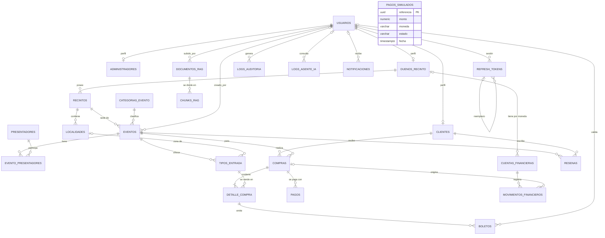

# Base de datos — Promotora de Eventos (v2)

Motor: **PostgreSQL 16** con extensión **pgvector**. Migraciones: **Flyway** (`database/migrations/V*.sql`).

Este documento explica el modelo **objetivo (v2)**: el script original más las correcciones de la revisión. Las migraciones de `database/migrations/` son la fuente de verdad del esquema implementado. Consulta este documento antes de escribir entidades, repositorios o SQL. Si aquí falta un tipo, clave o nulabilidad de una tabla existente, sigue [`referencia/schema_v1.sql`](referencia/schema_v1.sql), aplicando las correcciones v2. Ese script es solo referencia histórica: nunca se ejecuta ni se mueve a las migraciones. Para tablas nuevas, sigue lo descrito aquí y anota cada suposición en el encabezado de la migración. F1-11 regeneró el diccionario completo desde V1–V9.

**Leyenda**

| Marca | Significado |
|---|---|
| ✅ | Existe tal cual en el script original (v1) |
| 🔧 | Existe en v1 y cambia en v2 |
| ➕ | Tabla o columna nueva en v2 |
| ➕* | Ajuste menor añadido para completar el diseño; confirmado en F1-01 |

> El script con `DROP TABLE` de v1 es solo para desarrollo. En v2 el esquema se construye con migraciones Flyway; **nunca se ejecutan `DROP` contra una BD con datos**.

---

## 1. Visión general

27 tablas agrupadas por módulo (coinciden con los módulos de código); F6-11 añade el diario del proveedor simulado aprobado por el usuario:

| Módulo | Tablas | Propósito |
|---|---|---|
| Identity | `usuarios`, `clientes`, `administradores`, `duenos_recinto`, `refresh_tokens` | Cuentas, roles, perfiles y renovación de sesión |
| Venues | `recintos`, `localidades` | Lugares físicos y sus zonas (mapa) |
| Catalog | `categorias_evento`, `presentadores`, `eventos`, `evento_presentadores`, `tipos_entrada` | Qué se vende y a qué precio/cupo |
| Ticketing | `compras`, `detalle_compra`, `boletos` | Venta y emisión de boletos |
| Finance | `pagos`, `pagos_simulados`, `cuentas_financieras`, `movimientos_financieros` | Dinero: intentos, diario del proveedor simulado, cuentas y ledger |
| Reviews | `resenas` | Opiniones de clientes |
| AI | `documentos_rag`, `chunks_rag`, `logs_agente_ia` | RAG y trazabilidad del agente |
| Audit / Messaging | `logs_auditoria`, `notificaciones`, `outbox_mensajes`, `mensajes_procesados` | Auditoría y mensajería confiable |
| BI | esquema `bi` (vistas) | Reportería y Power BI |

### Ajustes menores añadidos (➕*) — confirmados (F1-01)
1. `activo BOOLEAN NOT NULL DEFAULT true` en `recintos`, `localidades`, `presentadores`, `categorias_evento`, `tipos_entrada` (permite "eliminar" sin borrar historia).
2. Estado `EXPIRADA` en `compras` (distingue "no pagó a tiempo" de "cancelada por el usuario").
3. `compras.evento_id` (una compra = un evento; simplifica finanzas y reportes).
4. `documentos_rag.estado` y `subido_por`; `outbox_mensajes.fecha_publicado` e `intentos`.
5. `pagos.metodo` y `movimientos_financieros.descripcion`.

---

## 2. Diagrama entidad-relación



`outbox_mensajes` y `mensajes_procesados` no tienen FK: son infraestructura de mensajería referenciada por valor (`agregado`, `agregado_id`, `mensaje_id`).

`pagos_simulados` tampoco tiene FK: `referencia` coincide por valor con `compras.public_id`, pero el resultado del proveedor se confirma en una conexión independiente y debe sobrevivir al rollback de la compra. No representa el ledger ni una pasarela externa.

---

## 3. Convenciones globales (🔧 respecto a v1)

| Tema | Regla v2 |
|---|---|
| Fechas | **`TIMESTAMPTZ`** en todas las columnas de fecha/hora (v1 usaba `TIMESTAMP`). El código trabaja en UTC |
| Claves | `GENERATED ALWAYS AS IDENTITY` en lugar de `SERIAL`. Tablas de alto volumen: `BIGINT` |
| IDs públicos | `compras` y `boletos` tienen `public_id UUID` (`gen_random_uuid()`, `UNIQUE`). La API **nunca** expone el ID entero de estas tablas (evita enumeración) |
| Nombres | `snake_case`, español, plural en tablas |
| Borrado | Usuarios, datos transaccionales y financieros: **nunca `DELETE`**, solo cambio de estado. Usuarios: `estado = INACTIVO`. Catálogos: baja lógica con `activo = false` |
| FK | `ON DELETE RESTRICT` por defecto y en toda FK hacia `usuarios`, incluidos perfiles, logs y notificaciones. `CASCADE` solo en relaciones de pertenencia pura autorizadas (chunk→documento, reseña→evento) |
| Dinero | `NUMERIC(10,2)` en compras/detalle/pagos; `NUMERIC(12,2)` en cuentas/movimientos. Moneda por defecto **GTQ** |
| Estados | `VARCHAR` + `CHECK` (no ENUM nativo) para poder cambiarlos con migraciones simples |
| Rol único | Cada usuario tiene **un** rol (`usuarios.rol`) y exactamente una fila en la tabla de perfil correspondiente. Validación en aplicación y constraint trigger **obligatorio**, `DEFERRABLE INITIALLY DEFERRED`, que verifica la invariante al COMMIT. Si algún día un usuario necesita varios roles, se migra a `usuarios_roles` |

---

## 4. Diccionario de datos

Regenerado en F1-11 desde los catálogos de PostgreSQL 16 tras aplicar V1–V9 con Flyway (26 tablas y 198 columnas), ampliado en F6-11 con V11: **27 tablas y 203 columnas**. Los tipos, claves, nulabilidad, defaults, CHECKs e índices siguientes reflejan las migraciones, que son la fuente de verdad. — indica ausencia de default o clave; los IDs numéricos usan GENERATED ALWAYS AS IDENTITY. Los triggers de integridad se describen en §6; el DDL completo permanece en database/migrations/.

### 4.1 Identity

#### `usuarios` 🔧
Cuenta de acceso de cualquier persona. Es el discriminador de rol. Normalizar email a minúsculas en Application; password_hash contiene un hash con sal (Argon2/BCrypt/PBKDF2), nunca SHA simple. debe_cambiar_password es true para el SUPERADMIN inicial creado por bootstrap.

| Columna | Tipo PostgreSQL | Nulabilidad | Default / generación | Claves |
|---|---|---|---|---|
| `id` | `integer` | NOT NULL | `GENERATED ALWAYS AS IDENTITY` | `PK (usuarios_pkey)` |
| `email` | `character varying(150)` | NOT NULL | — | `UNIQUE (uq_usuarios_email)` |
| `password_hash` | `character varying(255)` | NOT NULL | — | — |
| `debe_cambiar_password` | `boolean` | NOT NULL | `false` | — |
| `nombre` | `character varying(100)` | NOT NULL | — | — |
| `apellido` | `character varying(100)` | NOT NULL | — | — |
| `rol` | `character varying(20)` | NOT NULL | — | — |
| `estado` | `character varying(20)` | NOT NULL | `'ACTIVO'::character varying` | — |
| `fecha_registro` | `timestamp with time zone` | NOT NULL | `now()` | — |

Restricciones de la tabla (PK, FK, UNIQUE y CHECK):

- `ck_usuarios_estado`: `CHECK (estado::text = ANY (ARRAY['ACTIVO'::character varying, 'INACTIVO'::character varying, 'SUSPENDIDO'::character varying]::text[]))`.
- `ck_usuarios_rol`: `CHECK (rol::text = ANY (ARRAY['CLIENTE'::character varying, 'ADMINISTRADOR'::character varying, 'DUENO_RECINTO'::character varying]::text[]))`.
- `usuarios_pkey`: `PRIMARY KEY (id)`.
- `uq_usuarios_email`: `UNIQUE (email)`.

#### `clientes` ✅
Perfiles 1:1 con `usuarios` (`usuario_id INT NOT NULL UNIQUE`, `ON DELETE RESTRICT`). Nunca se borra físicamente un usuario; su baja es `estado = INACTIVO`.

| Columna | Tipo PostgreSQL | Nulabilidad | Default / generación | Claves |
|---|---|---|---|---|
| `id` | `integer` | NOT NULL | `GENERATED ALWAYS AS IDENTITY` | `PK (clientes_pkey)` |
| `usuario_id` | `integer` | NOT NULL | — | `FK (fk_clientes_usuario); UNIQUE (uq_clientes_usuario)` |
| `fecha_nacimiento` | `date` | NULL | — | — |
| `telefono` | `character varying(20)` | NULL | — | — |

Restricciones de la tabla (PK, FK, UNIQUE y CHECK):

- `fk_clientes_usuario`: `FOREIGN KEY (usuario_id) REFERENCES usuarios(id) ON DELETE RESTRICT`.
- `clientes_pkey`: `PRIMARY KEY (id)`.
- `uq_clientes_usuario`: `UNIQUE (usuario_id)`.

#### `administradores` ✅

| Columna | Tipo PostgreSQL | Nulabilidad | Default / generación | Claves |
|---|---|---|---|---|
| `id` | `integer` | NOT NULL | `GENERATED ALWAYS AS IDENTITY` | `PK (administradores_pkey)` |
| `usuario_id` | `integer` | NOT NULL | — | `FK (fk_administradores_usuario); UNIQUE (uq_administradores_usuario)` |
| `nivel_acceso` | `character varying(20)` | NOT NULL | `'ESTANDAR'::character varying` | — |

Restricciones de la tabla (PK, FK, UNIQUE y CHECK):

- `ck_administradores_nivel_acceso`: `CHECK (nivel_acceso::text = ANY (ARRAY['ESTANDAR'::character varying, 'SUPERADMIN'::character varying]::text[]))`.
- `fk_administradores_usuario`: `FOREIGN KEY (usuario_id) REFERENCES usuarios(id) ON DELETE RESTRICT`.
- `administradores_pkey`: `PRIMARY KEY (id)`.
- `uq_administradores_usuario`: `UNIQUE (usuario_id)`.

#### `duenos_recinto` ✅

| Columna | Tipo PostgreSQL | Nulabilidad | Default / generación | Claves |
|---|---|---|---|---|
| `id` | `integer` | NOT NULL | `GENERATED ALWAYS AS IDENTITY` | `PK (duenos_recinto_pkey)` |
| `usuario_id` | `integer` | NOT NULL | — | `FK (fk_duenos_recinto_usuario); UNIQUE (uq_duenos_recinto_usuario)` |
| `empresa` | `character varying(150)` | NOT NULL | — | — |
| `nit` | `character varying(20)` | NULL | — | — |

Restricciones de la tabla (PK, FK, UNIQUE y CHECK):

- `fk_duenos_recinto_usuario`: `FOREIGN KEY (usuario_id) REFERENCES usuarios(id) ON DELETE RESTRICT`.
- `duenos_recinto_pkey`: `PRIMARY KEY (id)`.
- `uq_duenos_recinto_usuario`: `UNIQUE (usuario_id)`.

#### `refresh_tokens` ➕
Renovación de sesión con rotación obligatoria. Solo se almacena el hash SHA-256 del token, nunca el token en claro. Si se reutiliza un token ya revocado, se revoca toda su familia y se audita.

Índices por `usuario_id` y `familia_id`. Se crea en `V1__identidad.sql`.

| Columna | Tipo PostgreSQL | Nulabilidad | Default / generación | Claves |
|---|---|---|---|---|
| `id` | `bigint` | NOT NULL | `GENERATED ALWAYS AS IDENTITY` | `PK (refresh_tokens_pkey)` |
| `usuario_id` | `integer` | NOT NULL | — | `FK (fk_refresh_tokens_usuario)` |
| `token_hash` | `character varying(255)` | NOT NULL | — | `UNIQUE (uq_refresh_tokens_token_hash)` |
| `familia_id` | `uuid` | NOT NULL | — | — |
| `expira_en` | `timestamp with time zone` | NOT NULL | — | — |
| `revocado_en` | `timestamp with time zone` | NULL | — | — |
| `reemplazado_por_id` | `bigint` | NULL | — | `FK (fk_refresh_tokens_reemplazo)` |
| `ip_origen` | `character varying(45)` | NULL | — | — |
| `fecha_creacion` | `timestamp with time zone` | NOT NULL | `now()` | — |

Restricciones de la tabla (PK, FK, UNIQUE y CHECK):

- `fk_refresh_tokens_reemplazo`: `FOREIGN KEY (reemplazado_por_id) REFERENCES refresh_tokens(id) ON DELETE RESTRICT`.
- `fk_refresh_tokens_usuario`: `FOREIGN KEY (usuario_id) REFERENCES usuarios(id) ON DELETE RESTRICT`.
- `refresh_tokens_pkey`: `PRIMARY KEY (id)`.
- `uq_refresh_tokens_token_hash`: `UNIQUE (token_hash)`.

Índices adicionales (incluidos los únicos parciales):

- `CREATE INDEX idx_refresh_familia ON public.refresh_tokens USING btree (familia_id)`.
- `CREATE INDEX idx_refresh_usuario ON public.refresh_tokens USING btree (usuario_id)`.

---

### 4.2 Venues

#### `recintos` 🔧
Lugar físico (estadio, iglesia, parque...).

| Columna | Tipo PostgreSQL | Nulabilidad | Default / generación | Claves |
|---|---|---|---|---|
| `id` | `integer` | NOT NULL | `GENERATED ALWAYS AS IDENTITY` | `PK (recintos_pkey)` |
| `dueno_id` | `integer` | NOT NULL | — | `FK (fk_recintos_dueno)` |
| `nombre` | `character varying(150)` | NOT NULL | — | — |
| `direccion` | `character varying(255)` | NULL | — | — |
| `ciudad` | `character varying(100)` | NULL | — | — |
| `latitud` | `numeric(9,6)` | NULL | — | — |
| `longitud` | `numeric(9,6)` | NULL | — | — |
| `imagen_plano_url` | `character varying(255)` | NULL | — | — |
| `capacidad_total` | `integer` | NULL | — | — |
| `activo` | `boolean` | NOT NULL | `true` | — |
| `fecha_creacion` | `timestamp with time zone` | NOT NULL | `now()` | — |

Restricciones de la tabla (PK, FK, UNIQUE y CHECK):

- `ck_recintos_capacidad_total`: `CHECK (capacidad_total > 0)`.
- `fk_recintos_dueno`: `FOREIGN KEY (dueno_id) REFERENCES duenos_recinto(id) ON DELETE RESTRICT`.
- `recintos_pkey`: `PRIMARY KEY (id)`.

Índices adicionales (incluidos los únicos parciales):

- `CREATE INDEX idx_recintos_dueno ON public.recintos USING btree (dueno_id)`.

#### `localidades` 🔧
Zonas de un recinto (Palco, General, Gradas Norte...). Base del **mapa interactivo**.

geometria es JSONB con polígonos, por ejemplo `{"type":"polygon","points":[[10,20],[80,20],[80,60],[10,60]]}`; las coordenadas son relativas al tamaño de imagen_plano_url. color usa la representación #RRGGBB. Ambos pueden ser NULL mientras no se configure el mapa.

El frontend dibuja el plano y superpone las geometrías; al hacer clic en una zona consulta los `tipos_entrada` con `localidad_id` = esa zona.

| Columna | Tipo PostgreSQL | Nulabilidad | Default / generación | Claves |
|---|---|---|---|---|
| `id` | `integer` | NOT NULL | `GENERATED ALWAYS AS IDENTITY` | `PK (localidades_pkey)` |
| `recinto_id` | `integer` | NOT NULL | — | `FK (fk_localidades_recinto); UNIQUE (uq_localidades_recinto_nombre)` |
| `nombre` | `character varying(100)` | NOT NULL | — | `UNIQUE (uq_localidades_recinto_nombre)` |
| `capacidad` | `integer` | NOT NULL | — | — |
| `geometria` | `jsonb` | NULL | — | — |
| `color` | `character varying(7)` | NULL | — | — |
| `activo` | `boolean` | NOT NULL | `true` | — |

Restricciones de la tabla (PK, FK, UNIQUE y CHECK):

- `ck_localidades_capacidad`: `CHECK (capacidad > 0)`.
- `fk_localidades_recinto`: `FOREIGN KEY (recinto_id) REFERENCES recintos(id) ON DELETE CASCADE`.
- `localidades_pkey`: `PRIMARY KEY (id)`.
- `uq_localidades_recinto_nombre`: `UNIQUE (recinto_id, nombre)`.

---

### 4.3 Catalog

#### `categorias_evento` ✅
Catálogo semilla: Concierto, Partido, Vigilia, Culto, Carrera, Meet & Greet. `nombre` UNIQUE. (+ `activo` ➕*)

| Columna | Tipo PostgreSQL | Nulabilidad | Default / generación | Claves |
|---|---|---|---|---|
| `id` | `integer` | NOT NULL | `GENERATED ALWAYS AS IDENTITY` | `PK (categorias_evento_pkey)` |
| `nombre` | `character varying(50)` | NOT NULL | — | `UNIQUE (uq_categorias_evento_nombre)` |
| `descripcion` | `character varying(255)` | NULL | — | — |
| `activo` | `boolean` | NOT NULL | `true` | — |

Restricciones de la tabla (PK, FK, UNIQUE y CHECK):

- `categorias_evento_pkey`: `PRIMARY KEY (id)`.
- `uq_categorias_evento_nombre`: `UNIQUE (nombre)`.

#### `presentadores` ✅
Artistas, equipos, presentadores u organizaciones recurrentes. `tipo` ∈ `ARTISTA`, `EQUIPO`, `PRESENTADOR`, `ORGANIZACION`. Campos: `nombre`, `biografia`, `imagen_url` (+ `activo` ➕*).

| Columna | Tipo PostgreSQL | Nulabilidad | Default / generación | Claves |
|---|---|---|---|---|
| `id` | `integer` | NOT NULL | `GENERATED ALWAYS AS IDENTITY` | `PK (presentadores_pkey)` |
| `nombre` | `character varying(150)` | NOT NULL | — | — |
| `tipo` | `character varying(20)` | NOT NULL | — | — |
| `biografia` | `text` | NULL | — | — |
| `imagen_url` | `character varying(255)` | NULL | — | — |
| `activo` | `boolean` | NOT NULL | `true` | — |

Restricciones de la tabla (PK, FK, UNIQUE y CHECK):

- `ck_presentadores_tipo`: `CHECK (tipo::text = ANY (ARRAY['ARTISTA'::character varying, 'EQUIPO'::character varying, 'PRESENTADOR'::character varying, 'ORGANIZACION'::character varying]::text[]))`.
- `presentadores_pkey`: `PRIMARY KEY (id)`.

#### `eventos` 🔧

| Columna | Tipo PostgreSQL | Nulabilidad | Default / generación | Claves |
|---|---|---|---|---|
| `id` | `integer` | NOT NULL | `GENERATED ALWAYS AS IDENTITY` | `PK (eventos_pkey)` |
| `recinto_id` | `integer` | NOT NULL | — | `FK (fk_eventos_recinto)` |
| `categoria_id` | `integer` | NOT NULL | — | `FK (fk_eventos_categoria)` |
| `creado_por` | `integer` | NOT NULL | — | `FK (fk_eventos_creador)` |
| `nombre` | `character varying(150)` | NOT NULL | — | — |
| `descripcion` | `text` | NULL | — | — |
| `fecha_inicio` | `timestamp with time zone` | NOT NULL | — | — |
| `fecha_fin` | `timestamp with time zone` | NULL | — | — |
| `fecha_inicio_venta` | `timestamp with time zone` | NULL | — | — |
| `fecha_fin_venta` | `timestamp with time zone` | NULL | — | — |
| `max_boletos_por_compra` | `integer` | NOT NULL | `10` | — |
| `estado` | `character varying(20)` | NOT NULL | `'BORRADOR'::character varying` | — |
| `imagen_url` | `character varying(255)` | NULL | — | — |
| `fecha_creacion` | `timestamp with time zone` | NOT NULL | `now()` | — |

Restricciones de la tabla (PK, FK, UNIQUE y CHECK):

- `ck_eventos_estado`: `CHECK (estado::text = ANY (ARRAY['BORRADOR'::character varying, 'PROGRAMADO'::character varying, 'EN_VENTA'::character varying, 'AGOTADO'::character varying, 'FINALIZADO'::character varying, 'CANCELADO'::character varying]::text[]))`.
- `ck_eventos_fechas`: `CHECK (fecha_fin IS NULL OR fecha_fin >= fecha_inicio)`.
- `ck_eventos_max_boletos`: `CHECK (max_boletos_por_compra > 0)`.
- `ck_eventos_ventana_venta`: `CHECK (fecha_inicio_venta IS NULL OR fecha_fin_venta IS NULL OR fecha_fin_venta >= fecha_inicio_venta)`.
- `fk_eventos_categoria`: `FOREIGN KEY (categoria_id) REFERENCES categorias_evento(id) ON DELETE RESTRICT`.
- `fk_eventos_creador`: `FOREIGN KEY (creado_por) REFERENCES usuarios(id) ON DELETE RESTRICT`.
- `fk_eventos_recinto`: `FOREIGN KEY (recinto_id) REFERENCES recintos(id) ON DELETE RESTRICT`.
- `eventos_pkey`: `PRIMARY KEY (id)`.

Índices adicionales (incluidos los únicos parciales):

- `CREATE INDEX idx_eventos_categoria ON public.eventos USING btree (categoria_id)`.
- `CREATE INDEX idx_eventos_creador ON public.eventos USING btree (creado_por)`.
- `CREATE INDEX idx_eventos_estado ON public.eventos USING btree (estado)`.
- `CREATE INDEX idx_eventos_fecha_inicio ON public.eventos USING btree (fecha_inicio)`.
- `CREATE INDEX idx_eventos_recinto ON public.eventos USING btree (recinto_id)`.

#### `evento_presentadores` ➕
Relación N:M evento–presentador. PK (`evento_id`, `presentador_id`); `evento_id` `CASCADE`, `presentador_id` `RESTRICT`; `rol VARCHAR(30)` (HEADLINER, INVITADO, LOCAL, VISITANTE...).
Permite que un festival tenga varios artistas y que las **reseñas se agreguen por presentador** (`resenas → eventos → evento_presentadores → presentadores`).

| Columna | Tipo PostgreSQL | Nulabilidad | Default / generación | Claves |
|---|---|---|---|---|
| `evento_id` | `integer` | NOT NULL | — | `FK (fk_evento_presentadores_evento); PK (pk_evento_presentadores)` |
| `presentador_id` | `integer` | NOT NULL | — | `FK (fk_evento_presentadores_presentador); PK (pk_evento_presentadores)` |
| `rol` | `character varying(30)` | NULL | — | — |

Restricciones de la tabla (PK, FK, UNIQUE y CHECK):

- `fk_evento_presentadores_evento`: `FOREIGN KEY (evento_id) REFERENCES eventos(id) ON DELETE CASCADE`.
- `fk_evento_presentadores_presentador`: `FOREIGN KEY (presentador_id) REFERENCES presentadores(id) ON DELETE RESTRICT`.
- `pk_evento_presentadores`: `PRIMARY KEY (evento_id, presentador_id)`.

Índices adicionales (incluidos los únicos parciales):

- `CREATE INDEX idx_evento_presentadores_presentador ON public.evento_presentadores USING btree (presentador_id)`.

#### `tipos_entrada` 🔧
Lo que realmente se vende. Una sola tabla cubre tres casos:

| Caso | Cómo se modela |
|---|---|
| Entrada general | `localidad_id = NULL`, nombre "General" |
| Venta por localidad | `localidad_id` apunta a la zona; precio y cupo propios |
| Carrera | Una fila por distancia: "5K", "10K", "21K", "42K" (sin localidad) |

**`cupo_disponible` solo se modifica con `UPDATE` atómico** (ver §7.1). Es el punto crítico anti-sobreventa.

| Columna | Tipo PostgreSQL | Nulabilidad | Default / generación | Claves |
|---|---|---|---|---|
| `id` | `integer` | NOT NULL | `GENERATED ALWAYS AS IDENTITY` | `PK (tipos_entrada_pkey)` |
| `evento_id` | `integer` | NOT NULL | — | `FK (fk_tipos_entrada_evento)` |
| `localidad_id` | `integer` | NULL | — | `FK (fk_tipos_entrada_localidad)` |
| `nombre` | `character varying(100)` | NOT NULL | — | — |
| `precio` | `numeric(10,2)` | NOT NULL | — | — |
| `cupo_total` | `integer` | NOT NULL | — | — |
| `cupo_disponible` | `integer` | NOT NULL | — | — |
| `activo` | `boolean` | NOT NULL | `true` | — |

Restricciones de la tabla (PK, FK, UNIQUE y CHECK):

- `ck_tipos_entrada_cupo_disponible`: `CHECK (cupo_disponible >= 0 AND cupo_disponible <= cupo_total)`.
- `ck_tipos_entrada_cupo_total`: `CHECK (cupo_total >= 0)`.
- `ck_tipos_entrada_precio`: `CHECK (precio >= 0::numeric)`.
- `fk_tipos_entrada_evento`: `FOREIGN KEY (evento_id) REFERENCES eventos(id) ON DELETE CASCADE`.
- `fk_tipos_entrada_localidad`: `FOREIGN KEY (localidad_id) REFERENCES localidades(id) ON DELETE RESTRICT`.
- `tipos_entrada_pkey`: `PRIMARY KEY (id)`.

Índices adicionales (incluidos los únicos parciales):

- `CREATE INDEX idx_tipos_entrada_evento ON public.tipos_entrada USING btree (evento_id)`.
- `CREATE INDEX idx_tipos_entrada_localidad ON public.tipos_entrada USING btree (localidad_id)`.

---

### 4.4 Ticketing

#### `compras` 🔧
Cabecera de una orden. Nunca se borra.

| Columna | Tipo PostgreSQL | Nulabilidad | Default / generación | Claves |
|---|---|---|---|---|
| `id` | `integer` | NOT NULL | `GENERATED ALWAYS AS IDENTITY` | `PK (compras_pkey)` |
| `public_id` | `uuid` | NOT NULL | `gen_random_uuid()` | `UNIQUE (uq_compras_public_id)` |
| `cliente_id` | `integer` | NOT NULL | — | `FK (fk_compras_cliente)` |
| `evento_id` | `integer` | NOT NULL | — | `FK (fk_compras_evento)` |
| `fecha_compra` | `timestamp with time zone` | NOT NULL | `now()` | — |
| `estado` | `character varying(20)` | NOT NULL | `'PENDIENTE'::character varying` | — |
| `expira_en` | `timestamp with time zone` | NOT NULL | — | — |
| `procesando_desde` | `timestamp with time zone` | NULL | — | — |
| `idempotency_key` | `character varying(100)` | NOT NULL | — | `UNIQUE (uq_compras_idempotency_key)` |
| `moneda` | `character(3)` | NOT NULL | `'GTQ'::bpchar` | — |
| `subtotal` | `numeric(10,2)` | NOT NULL | `0` | — |
| `impuestos` | `numeric(10,2)` | NOT NULL | `0` | — |
| `comision_plataforma` | `numeric(10,2)` | NOT NULL | `0` | — |
| `total` | `numeric(10,2)` | NOT NULL | `0` | — |

Restricciones de la tabla (PK, FK, UNIQUE y CHECK):

- `ck_compras_estado`: `CHECK (estado::text = ANY (ARRAY['PENDIENTE'::character varying, 'PROCESANDO'::character varying, 'COMPLETADA'::character varying, 'CANCELADA'::character varying, 'FALLIDA'::character varying, 'EXPIRADA'::character varying]::text[]))`.
- `ck_compras_importes`: `CHECK (subtotal >= 0::numeric AND impuestos >= 0::numeric AND comision_plataforma >= 0::numeric AND total >= 0::numeric)`.
- `ck_compras_total`: `CHECK (total = (subtotal + impuestos + comision_plataforma))`.
- `fk_compras_cliente`: `FOREIGN KEY (cliente_id) REFERENCES clientes(id) ON DELETE RESTRICT`.
- `fk_compras_evento`: `FOREIGN KEY (evento_id) REFERENCES eventos(id) ON DELETE RESTRICT`.
- `compras_pkey`: `PRIMARY KEY (id)`.
- `uq_compras_idempotency_key`: `UNIQUE (idempotency_key)`.
- `uq_compras_public_id`: `UNIQUE (public_id)`.

Índices adicionales (incluidos los únicos parciales):

- `CREATE INDEX idx_compras_cliente ON public.compras USING btree (cliente_id)`.
- `CREATE INDEX idx_compras_estado ON public.compras USING btree (estado)`.
- `CREATE INDEX idx_compras_evento ON public.compras USING btree (evento_id)`.
- `CREATE INDEX idx_compras_expiracion ON public.compras USING btree (expira_en) WHERE ((estado)::text = 'PENDIENTE'::text)`.
- `CREATE INDEX idx_compras_fecha ON public.compras USING btree (fecha_compra)`.
- `CREATE INDEX idx_compras_procesando ON public.compras USING btree (procesando_desde) WHERE ((estado)::text = 'PROCESANDO'::text)`.

#### `detalle_compra` 🔧
Líneas de la compra: (tipo de entrada, cantidad, precio). `precio_unitario` es una **copia congelada** del precio al comprar.

Regla: `tipos_entrada.evento_id` debe ser igual a `compras.evento_id` (trigger/aplicación).

| Columna | Tipo PostgreSQL | Nulabilidad | Default / generación | Claves |
|---|---|---|---|---|
| `id` | `integer` | NOT NULL | `GENERATED ALWAYS AS IDENTITY` | `PK (detalle_compra_pkey)` |
| `compra_id` | `integer` | NOT NULL | — | `FK (fk_detalle_compra_compra)` |
| `tipo_entrada_id` | `integer` | NOT NULL | — | `FK (fk_detalle_compra_tipo_entrada)` |
| `cantidad` | `integer` | NOT NULL | — | — |
| `precio_unitario` | `numeric(10,2)` | NOT NULL | — | — |
| `subtotal` | `numeric(10,2)` | NOT NULL | — | — |

Restricciones de la tabla (PK, FK, UNIQUE y CHECK):

- `ck_detalle_compra_cantidad`: `CHECK (cantidad > 0)`.
- `ck_detalle_compra_importes`: `CHECK (precio_unitario >= 0::numeric AND subtotal >= 0::numeric)`.
- `ck_detalle_compra_subtotal`: `CHECK (subtotal = (cantidad::numeric * precio_unitario))`.
- `fk_detalle_compra_compra`: `FOREIGN KEY (compra_id) REFERENCES compras(id) ON DELETE RESTRICT`.
- `fk_detalle_compra_tipo_entrada`: `FOREIGN KEY (tipo_entrada_id) REFERENCES tipos_entrada(id) ON DELETE RESTRICT`.
- `detalle_compra_pkey`: `PRIMARY KEY (id)`.

Índices adicionales (incluidos los únicos parciales):

- `CREATE INDEX idx_detalle_compra_compra ON public.detalle_compra USING btree (compra_id)`.
- `CREATE INDEX idx_detalle_compra_tipo ON public.detalle_compra USING btree (tipo_entrada_id)`.

#### `boletos` 🔧
Un boleto = una persona = un QR. Se **generan** al completarse la compra (una fila por unidad de `cantidad`). codigo_qr contiene un token firmado HMAC-SHA256; UNIQUE no valida la firma. Application exige nombre_asistente y documento_identidad para carreras, aunque sean nullable en BD; datos_extra puede incluir talla de camiseta y contacto de emergencia. fecha_uso y validado_por registran la validación en puerta.

Acuerdo F6-03/F6-04: POST /api/v1/compras recibe asistentes por ítem. Mientras la compra está pendiente, se conservan en `outbox_mensajes.payload`, asociados a tipo_entrada_id, sin nuevas tablas o columnas. El Worker los relaciona con detalle_compra al emitir; RabbitMQ recibe solamente publicId. El outbox conserva estos datos después de publicar, sin purga automática definida; no se copian a logs ni DLQ.

| Columna | Tipo PostgreSQL | Nulabilidad | Default / generación | Claves |
|---|---|---|---|---|
| `id` | `bigint` | NOT NULL | `GENERATED ALWAYS AS IDENTITY` | `PK (boletos_pkey)` |
| `public_id` | `uuid` | NOT NULL | `gen_random_uuid()` | `UNIQUE (uq_boletos_public_id)` |
| `detalle_compra_id` | `integer` | NOT NULL | — | `FK (fk_boletos_detalle_compra)` |
| `codigo_qr` | `character varying(100)` | NOT NULL | — | `UNIQUE (uq_boletos_codigo_qr)` |
| `estado` | `character varying(20)` | NOT NULL | `'VALIDO'::character varying` | — |
| `nombre_asistente` | `character varying` | NULL | — | — |
| `documento_identidad` | `character varying` | NULL | — | — |
| `datos_extra` | `jsonb` | NULL | — | — |
| `fecha_emision` | `timestamp with time zone` | NOT NULL | `now()` | — |
| `fecha_uso` | `timestamp with time zone` | NULL | — | — |
| `validado_por` | `integer` | NULL | — | `FK (fk_boletos_validador)` |

Restricciones de la tabla (PK, FK, UNIQUE y CHECK):

- `ck_boletos_estado`: `CHECK (estado::text = ANY (ARRAY['VALIDO'::character varying, 'USADO'::character varying, 'ANULADO'::character varying]::text[]))`.
- `fk_boletos_detalle_compra`: `FOREIGN KEY (detalle_compra_id) REFERENCES detalle_compra(id) ON DELETE RESTRICT`.
- `fk_boletos_validador`: `FOREIGN KEY (validado_por) REFERENCES usuarios(id) ON DELETE RESTRICT`.
- `boletos_pkey`: `PRIMARY KEY (id)`.
- `uq_boletos_codigo_qr`: `UNIQUE (codigo_qr)`.
- `uq_boletos_public_id`: `UNIQUE (public_id)`.

Índices adicionales (incluidos los únicos parciales):

- `CREATE INDEX idx_boletos_detalle ON public.boletos USING btree (detalle_compra_id)`.
- `CREATE INDEX idx_boletos_estado ON public.boletos USING btree (estado)`.

---

### 4.5 Finance

#### `pagos_simulados` ➕ — F6-11, aprobación explícita del usuario

Diario del proveedor simulado: una fila inmutable por referencia; no se borra ni sobrescribe al cambiar tasas o reiniciar el host. Solo SELECT/INSERT para promotora_app; trigger bloquea UPDATE/DELETE/TRUNCATE incluso al propietario. bi_reader no tiene acceso. No contiene secretos ni datos de tarjeta.

| Columna | Tipo PostgreSQL | Nulabilidad | Default / generación | Claves |
|---|---|---|---|---|
| `referencia` | `uuid` | NOT NULL | — | PK, sin FK |
| `monto` | `numeric(10,2)` | NOT NULL | — | CHECK monto >= 0 |
| `moneda` | `character varying(3)` | NOT NULL | — | CHECK moneda = 'GTQ' |
| `estado` | `character varying(20)` | NOT NULL | — | CHECK estado IN ('APROBADO','RECHAZADO') |
| `fecha` | `timestamp with time zone` | NOT NULL | `now()` | — |

La PK proporciona unicidad e índice de consulta. Sin índices adicionales. El adaptador inserta con ON CONFLICT DO NOTHING, consulta la fila confirmada y exige los mismos importes. Ausencia tras consulta exitosa significa que este simulador durable no registró cobro; error de consulta no significa ausencia. Un pago/ledger/boleto histórico sin respaldo consistente requiere conciliación, no devolución automática.

#### `pagos` ➕
Intentos de cobro de una compra (una compra puede tener varios si el primero falla).

| Columna | Tipo PostgreSQL | Nulabilidad | Default / generación | Claves |
|---|---|---|---|---|
| `id` | `bigint` | NOT NULL | `GENERATED ALWAYS AS IDENTITY` | `PK (pagos_pkey)` |
| `compra_id` | `integer` | NOT NULL | — | `FK (fk_pagos_compra)` |
| `pasarela` | `character varying(30)` | NOT NULL | — | — |
| `metodo` | `character varying(30)` | NULL | — | — |
| `referencia` | `character varying(100)` | NULL | — | — |
| `monto` | `numeric(10,2)` | NOT NULL | — | — |
| `estado` | `character varying(20)` | NOT NULL | `'PENDIENTE'::character varying` | — |
| `respuesta` | `jsonb` | NULL | — | — |
| `fecha` | `timestamp with time zone` | NOT NULL | `now()` | — |

Restricciones de la tabla (PK, FK, UNIQUE y CHECK):

- `ck_pagos_estado`: `CHECK (estado::text = ANY (ARRAY['PENDIENTE'::character varying, 'APROBADO'::character varying, 'RECHAZADO'::character varying, 'REEMBOLSADO'::character varying]::text[]))`.
- `ck_pagos_monto`: `CHECK (monto >= 0::numeric)`.
- `fk_pagos_compra`: `FOREIGN KEY (compra_id) REFERENCES compras(id) ON DELETE RESTRICT`.
- `pagos_pkey`: `PRIMARY KEY (id)`.

Índices adicionales (incluidos los únicos parciales):

- `CREATE INDEX idx_pagos_compra ON public.pagos USING btree (compra_id)`.

#### `cuentas_financieras` ➕
Dónde "vive" el dinero. Por moneda: una cuenta `PLATAFORMA` (comisiones), una `IMPUESTOS` (IVA) y una `DUENO` por dueño de recinto (ventas).

Consultas F7-06 aprobadas: GET /api/v1/cuentas, GET /api/v1/cuentas/{id} y GET /api/v1/cuentas/{id}/movimientos. Administradores consultan todas; dueños solo propias, incluidas cerradas. Listados paginados (default 20, máximo 100); cuentas por dueño/moneda/tipo/estado, extracto por tipo/compra/intervalo UTC desde inclusivo/hasta exclusivo, orden fecha e ID descendentes. Sin cambios de esquema. Contrato completo en [CONSULTAS_FINANCIERAS.md](CONSULTAS_FINANCIERAS.md).

Índices únicos parciales: `UNIQUE(moneda) WHERE tipo='PLATAFORMA'` y `UNIQUE(moneda) WHERE tipo='IMPUESTOS'`.
Solo se cierra una cuenta DUENO con saldo = 0. PLATAFORMA e IMPUESTOS no se cierran. Un trigger rechaza movimientos en cuentas CERRADA.

| Columna | Tipo PostgreSQL | Nulabilidad | Default / generación | Claves |
|---|---|---|---|---|
| `id` | `integer` | NOT NULL | `GENERATED ALWAYS AS IDENTITY` | `PK (cuentas_financieras_pkey)` |
| `tipo` | `character varying(20)` | NOT NULL | — | — |
| `dueno_id` | `integer` | NULL | — | `FK (fk_cuentas_financieras_dueno); UNIQUE (uq_cuentas_financieras_dueno_moneda)` |
| `moneda` | `character(3)` | NOT NULL | `'GTQ'::bpchar` | `UNIQUE (uq_cuentas_financieras_dueno_moneda)` |
| `saldo` | `numeric(12,2)` | NOT NULL | `0` | — |
| `estado` | `character varying(20)` | NOT NULL | `'ACTIVA'::character varying` | — |
| `fecha_cierre` | `timestamp with time zone` | NULL | — | — |

Restricciones de la tabla (PK, FK, UNIQUE y CHECK):

- `ck_cuentas_financieras_cierre`: `CHECK (estado::text <> 'CERRADA'::text OR tipo::text = 'DUENO'::text AND saldo = 0::numeric)`.
- `ck_cuentas_financieras_dueno`: `CHECK ((tipo::text = 'DUENO'::text) = (dueno_id IS NOT NULL))`.
- `ck_cuentas_financieras_estado`: `CHECK (estado::text = ANY (ARRAY['ACTIVA'::character varying, 'CERRADA'::character varying]::text[]))`.
- `ck_cuentas_financieras_tipo`: `CHECK (tipo::text = ANY (ARRAY['PLATAFORMA'::character varying, 'DUENO'::character varying, 'IMPUESTOS'::character varying]::text[]))`.
- `fk_cuentas_financieras_dueno`: `FOREIGN KEY (dueno_id) REFERENCES duenos_recinto(id) ON DELETE RESTRICT`.
- `cuentas_financieras_pkey`: `PRIMARY KEY (id)`.
- `uq_cuentas_financieras_dueno_moneda`: `UNIQUE (dueno_id, moneda)`.

Índices adicionales (incluidos los únicos parciales):

- `CREATE UNIQUE INDEX uq_cuentas_impuestos_moneda ON public.cuentas_financieras USING btree (moneda) WHERE ((tipo)::text = 'IMPUESTOS'::text)`.
- `CREATE UNIQUE INDEX uq_cuentas_plataforma_moneda ON public.cuentas_financieras USING btree (moneda) WHERE ((tipo)::text = 'PLATAFORMA'::text)`.

#### `movimientos_financieros` ➕ (ledger inmutable)
Cada cambio de dinero es una fila. **Solo `INSERT`** (se revoca `UPDATE`/`DELETE`). monto tiene signo: positivo suma al saldo, negativo resta; descripcion admite texto libre.

| Evento de negocio | Movimientos |
|---|---|
| Compra completada | `VENTA` +subtotal en cuenta del dueño · `COMISION` +comision_plataforma en PLATAFORMA · `IMPUESTO` +impuestos en IMPUESTOS |
| Reembolso | `REEMBOLSO` revierte los tres componentes en las mismas cuentas |
| Liquidación al dueño | `LIQUIDACION` negativo en la cuenta del dueño (retiro) |

Contrato F7-05 aprobado: POST /api/v1/cuentas/{id}/liquidar solo ADMINISTRADOR habilitado, con monto positivo de hasta dos decimales e Idempotency-Key por cuenta. Una operación nueva requiere DUENO ACTIVA, saldo suficiente y conciliado; el débito, saldo y auditoría comparten transacción. compra_id queda NULL. descripcion reserva `liquidacion:v1:<SHA-256 hexadecimal de la clave UTF-8>`; buscar e insertar bajo bloqueo de cuenta evita duplicados sin cambiar esquema. No existe un índice único para esa referencia: todo escritor debe seguir el protocolo. Repetir mismo monto devuelve el movimiento original; cambiarlo devuelve 409. Sin transferencia externa. Guía: [LIQUIDACIONES.md](LIQUIDACIONES.md).

Al completar una compra, la suma de sus movimientos de cobro debe igualar `compras.total` (antes de reembolsos). Los componentes de monto cero no generan movimientos, por el CHECK ≠ 0. La comisión es un cargo al cliente; el IVA se muestra aparte. Su tasa se configura en appsettings y el cálculo pertenece a Domain. La facturación electrónica queda fuera de alcance.

| Columna | Tipo PostgreSQL | Nulabilidad | Default / generación | Claves |
|---|---|---|---|---|
| `id` | `bigint` | NOT NULL | `GENERATED ALWAYS AS IDENTITY` | `PK (movimientos_financieros_pkey)` |
| `cuenta_id` | `integer` | NOT NULL | — | `FK (fk_movimientos_financieros_cuenta)` |
| `compra_id` | `integer` | NULL | — | `FK (fk_movimientos_financieros_compra)` |
| `tipo` | `character varying(20)` | NOT NULL | — | — |
| `monto` | `numeric(12,2)` | NOT NULL | — | — |
| `descripcion` | `text` | NULL | — | — |
| `fecha` | `timestamp with time zone` | NOT NULL | `now()` | — |

Restricciones de la tabla (PK, FK, UNIQUE y CHECK):

- `ck_movimientos_financieros_monto`: `CHECK (monto <> 0::numeric)`.
- `ck_movimientos_financieros_tipo`: `CHECK (tipo::text = ANY (ARRAY['VENTA'::character varying, 'COMISION'::character varying, 'IMPUESTO'::character varying, 'LIQUIDACION'::character varying, 'REEMBOLSO'::character varying]::text[]))`.
- `fk_movimientos_financieros_compra`: `FOREIGN KEY (compra_id) REFERENCES compras(id) ON DELETE RESTRICT`.
- `fk_movimientos_financieros_cuenta`: `FOREIGN KEY (cuenta_id) REFERENCES cuentas_financieras(id) ON DELETE RESTRICT`.
- `movimientos_financieros_pkey`: `PRIMARY KEY (id)`.

Índices adicionales (incluidos los únicos parciales):

- `CREATE INDEX idx_movimientos_cuenta_fecha ON public.movimientos_financieros USING btree (cuenta_id, fecha)`.

---

### 4.6 Reviews

#### `resenas` ✅
`calificacion` 1–5, `comentario`, `estado` ∈ `PENDIENTE`, `APROBADA`, `RECHAZADA`. UNIQUE (`evento_id`, `cliente_id`).
Reglas de aplicación: solo clientes con boleto `USADO` del evento; moderación por ADMINISTRADOR; el promedio por presentador sale de `resenas APROBADA → evento_presentadores`.

Contrato Fase 8 aprobado: comentario opcional máximo 510 caracteres, calificación 1–5. Crear nace PENDIENTE; autor puede editar para volver a PENDIENTE y retirar usando RECHAZADA sin DELETE, incluso editar rechazada/retirada para revisión. Moderador solo ADMINISTRADOR, desde PENDIENTE. Listados paginados y agregados públicos solo sobre APROBADA. Rutas y prueba local en [RESENAS.md](RESENAS.md). No se añade estado RETIRADA ni columnas. Elección de IA resuelta en D-05: Ollama Cloud para chat y Ollama local para embeddings.

| Columna | Tipo PostgreSQL | Nulabilidad | Default / generación | Claves |
|---|---|---|---|---|
| `id` | `integer` | NOT NULL | `GENERATED ALWAYS AS IDENTITY` | `PK (resenas_pkey)` |
| `evento_id` | `integer` | NOT NULL | — | `FK (fk_resenas_evento); UNIQUE (uq_resenas_evento_cliente)` |
| `cliente_id` | `integer` | NOT NULL | — | `FK (fk_resenas_cliente); UNIQUE (uq_resenas_evento_cliente)` |
| `calificacion` | `smallint` | NOT NULL | — | — |
| `comentario` | `text` | NULL | — | — |
| `estado` | `character varying(20)` | NOT NULL | `'PENDIENTE'::character varying` | — |
| `fecha_creacion` | `timestamp with time zone` | NOT NULL | `now()` | — |

Restricciones de la tabla (PK, FK, UNIQUE y CHECK):

- `ck_resenas_calificacion`: `CHECK (calificacion >= 1 AND calificacion <= 5)`.
- `ck_resenas_estado`: `CHECK (estado::text = ANY (ARRAY['PENDIENTE'::character varying, 'APROBADA'::character varying, 'RECHAZADA'::character varying]::text[]))`.
- `fk_resenas_cliente`: `FOREIGN KEY (cliente_id) REFERENCES clientes(id) ON DELETE CASCADE`.
- `fk_resenas_evento`: `FOREIGN KEY (evento_id) REFERENCES eventos(id) ON DELETE CASCADE`.
- `resenas_pkey`: `PRIMARY KEY (id)`.
- `uq_resenas_evento_cliente`: `UNIQUE (evento_id, cliente_id)`.

Índices adicionales (incluidos los únicos parciales):

- `CREATE INDEX idx_resenas_evento ON public.resenas USING btree (evento_id)`.

---

### 4.7 AI (RAG y agente)

#### `documentos_rag` 🔧
Documentos del negocio ingestados (reglamentos, políticas de reembolso, FAQ, guías de recinto).
Columnas: `titulo`, `tipo_documento`, `contenido` (texto extraído), `ruta_archivo`, `version`, `fecha_carga` (TIMESTAMPTZ), `estado` ➕* ∈ `PENDIENTE`, `INDEXADO`, `ERROR`, `INACTIVO`, `subido_por` ➕* (FK `usuarios`).
Solo los `INDEXADO` participan en la recuperación.

| Columna | Tipo PostgreSQL | Nulabilidad | Default / generación | Claves |
|---|---|---|---|---|
| `id` | `integer` | NOT NULL | `GENERATED ALWAYS AS IDENTITY` | `PK (documentos_rag_pkey)` |
| `titulo` | `character varying(200)` | NOT NULL | — | — |
| `tipo_documento` | `character varying(50)` | NULL | — | — |
| `contenido` | `text` | NULL | — | — |
| `ruta_archivo` | `character varying(255)` | NULL | — | — |
| `version` | `integer` | NOT NULL | `1` | — |
| `fecha_carga` | `timestamp with time zone` | NOT NULL | `now()` | — |
| `estado` | `character varying(20)` | NOT NULL | `'PENDIENTE'::character varying` | — |
| `subido_por` | `integer` | NOT NULL | — | `FK (fk_documentos_rag_usuario)` |

Restricciones de la tabla (PK, FK, UNIQUE y CHECK):

- `ck_documentos_rag_estado`: `CHECK (estado::text = ANY (ARRAY['PENDIENTE'::character varying, 'INDEXADO'::character varying, 'ERROR'::character varying, 'INACTIVO'::character varying]::text[]))`.
- `fk_documentos_rag_usuario`: `FOREIGN KEY (subido_por) REFERENCES usuarios(id) ON DELETE RESTRICT`.
- `documentos_rag_pkey`: `PRIMARY KEY (id)`.

#### `chunks_rag` ➕
Fragmentos de cada documento con su vector. embedding conserva dimensión 1536; D-05 selecciona qwen3-embedding:4b local con dimensions=1536. El modelo histórico era text-embedding-3-small; cambiar modelo obliga a reindexar aunque conserve dimensión, nunca mezclar vectores de modelos distintos. orden y pagina permiten citar el fragmento; metadata puede incluir sección e idioma.

Índice: `USING hnsw (embedding vector_cosine_ops)`.

| Columna | Tipo PostgreSQL | Nulabilidad | Default / generación | Claves |
|---|---|---|---|---|
| `id` | `bigint` | NOT NULL | `GENERATED ALWAYS AS IDENTITY` | `PK (chunks_rag_pkey)` |
| `documento_id` | `integer` | NOT NULL | — | `FK (fk_chunks_rag_documento)` |
| `orden` | `integer` | NOT NULL | — | — |
| `pagina` | `integer` | NULL | — | — |
| `contenido` | `text` | NOT NULL | — | — |
| `embedding` | `vector(1536)` | NOT NULL | — | — |
| `metadata` | `jsonb` | NULL | — | — |

Restricciones de la tabla (PK, FK, UNIQUE y CHECK):

- `fk_chunks_rag_documento`: `FOREIGN KEY (documento_id) REFERENCES documentos_rag(id) ON DELETE CASCADE`.
- `chunks_rag_pkey`: `PRIMARY KEY (id)`.

Índices adicionales (incluidos los únicos parciales):

- `CREATE INDEX idx_chunks_rag_embedding_hnsw ON public.chunks_rag USING hnsw (embedding vector_cosine_ops)`.

#### `logs_agente_ia` 🔧
Bitácora de cada consulta al agente.
Columnas v1: `usuario_id` (NULL si anónimo), `consulta`, `respuesta`, `fuentes_citadas JSONB`, `tiempo_respuesta_ms`, `fecha_hora`.
`usuario_id` referencia `usuarios` con ON DELETE RESTRICT. Solo INSERT: REVOKE de UPDATE/DELETE y trigger que bloquea ambas operaciones.
Nuevas ➕: `session_id UUID`, `modelo VARCHAR`, `tokens_entrada INT`, `tokens_salida INT`, `estado` ∈ `OK`, `SIN_CONTEXTO`, `ERROR`, `RECHAZADA`.

| Columna | Tipo PostgreSQL | Nulabilidad | Default / generación | Claves |
|---|---|---|---|---|
| `id` | `bigint` | NOT NULL | `GENERATED ALWAYS AS IDENTITY` | `PK (logs_agente_ia_pkey)` |
| `usuario_id` | `integer` | NULL | — | `FK (fk_logs_agente_ia_usuario)` |
| `consulta` | `text` | NOT NULL | — | — |
| `respuesta` | `text` | NULL | — | — |
| `fuentes_citadas` | `jsonb` | NULL | — | — |
| `tiempo_respuesta_ms` | `integer` | NULL | — | — |
| `fecha_hora` | `timestamp with time zone` | NOT NULL | `now()` | — |
| `session_id` | `uuid` | NOT NULL | — | — |
| `modelo` | `character varying` | NULL | — | — |
| `tokens_entrada` | `integer` | NULL | — | — |
| `tokens_salida` | `integer` | NULL | — | — |
| `estado` | `character varying(20)` | NOT NULL | — | — |

Restricciones de la tabla (PK, FK, UNIQUE y CHECK):

- `ck_logs_agente_ia_estado`: `CHECK (estado::text = ANY (ARRAY['OK'::character varying, 'SIN_CONTEXTO'::character varying, 'ERROR'::character varying, 'RECHAZADA'::character varying]::text[]))`.
- `fk_logs_agente_ia_usuario`: `FOREIGN KEY (usuario_id) REFERENCES usuarios(id) ON DELETE RESTRICT`.
- `logs_agente_ia_pkey`: `PRIMARY KEY (id)`.

Índices adicionales (incluidos los únicos parciales):

- `CREATE INDEX idx_logs_agente_fecha ON public.logs_agente_ia USING btree (fecha_hora)`.

---

### 4.8 Audit y mensajería

#### `logs_auditoria` 🔧
Quién hizo qué. `BIGINT`, solo `INSERT` (se revoca `UPDATE`/`DELETE` al rol de la aplicación).
Columnas: `usuario_id` (nullable, FK `usuarios` ON DELETE RESTRICT), `entidad_afectada`, **`entidad_id` ➕ VARCHAR(50)**, `accion`, `detalle JSONB`, `ip_origen`, `fecha_hora`. Solo INSERT: además del REVOKE, un trigger bloquea UPDATE/DELETE.
`accion` 🔧 ampliada: `CREATE`, `UPDATE`, `DELETE`, `LOGIN`, `LOGOUT`, `LOGIN_FAILED`, `PURCHASE`, `PAYMENT`, `REFUND`, `VALIDATE`, `MODERATE`, `EXPORT`, `INGEST`.
Índices: `usuario_id`, (`entidad_afectada`, `entidad_id`), `fecha_hora`.

| Columna | Tipo PostgreSQL | Nulabilidad | Default / generación | Claves |
|---|---|---|---|---|
| `id` | `bigint` | NOT NULL | `GENERATED ALWAYS AS IDENTITY` | `PK (logs_auditoria_pkey)` |
| `usuario_id` | `integer` | NULL | — | `FK (fk_logs_auditoria_usuario)` |
| `entidad_afectada` | `character varying(50)` | NOT NULL | — | — |
| `entidad_id` | `character varying(50)` | NULL | — | — |
| `accion` | `character varying(20)` | NOT NULL | — | — |
| `detalle` | `jsonb` | NULL | — | — |
| `ip_origen` | `character varying(45)` | NULL | — | — |
| `fecha_hora` | `timestamp with time zone` | NOT NULL | `now()` | — |

Restricciones de la tabla (PK, FK, UNIQUE y CHECK):

- `ck_logs_auditoria_accion`: `CHECK (accion::text = ANY (ARRAY['CREATE'::character varying, 'UPDATE'::character varying, 'DELETE'::character varying, 'LOGIN'::character varying, 'LOGOUT'::character varying, 'LOGIN_FAILED'::character varying, 'PURCHASE'::character varying, 'PAYMENT'::character varying, 'REFUND'::character varying, 'VALIDATE'::character varying, 'MODERATE'::character varying, 'EXPORT'::character varying, 'INGEST'::character varying]::text[]))`.
- `fk_logs_auditoria_usuario`: `FOREIGN KEY (usuario_id) REFERENCES usuarios(id) ON DELETE RESTRICT`.
- `logs_auditoria_pkey`: `PRIMARY KEY (id)`.

Índices adicionales (incluidos los únicos parciales):

- `CREATE INDEX idx_logs_auditoria_entidad ON public.logs_auditoria USING btree (entidad_afectada, entidad_id)`.
- `CREATE INDEX idx_logs_auditoria_fecha ON public.logs_auditoria USING btree (fecha_hora)`.
- `CREATE INDEX idx_logs_auditoria_usuario ON public.logs_auditoria USING btree (usuario_id)`.

#### `notificaciones` ✅
Evidencia de que el flujo asíncrono corrió (correos de confirmación, bienvenida). `tipo`, `estado` ∈ `PENDIENTE`, `ENVIADO`, `FALLIDO`, `mensaje`, `fecha_creacion`, `fecha_envio`. Índices por `estado` y 🔧 `usuario_id`.
`usuario_id` referencia `usuarios` con ON DELETE RESTRICT.

| Columna | Tipo PostgreSQL | Nulabilidad | Default / generación | Claves |
|---|---|---|---|---|
| `id` | `bigint` | NOT NULL | `GENERATED ALWAYS AS IDENTITY` | `PK (notificaciones_pkey)` |
| `usuario_id` | `integer` | NULL | — | `FK (fk_notificaciones_usuario)` |
| `tipo` | `character varying(50)` | NOT NULL | — | — |
| `estado` | `character varying(20)` | NOT NULL | `'PENDIENTE'::character varying` | — |
| `mensaje` | `text` | NULL | — | — |
| `fecha_creacion` | `timestamp with time zone` | NOT NULL | `now()` | — |
| `fecha_envio` | `timestamp with time zone` | NULL | — | — |

Restricciones de la tabla (PK, FK, UNIQUE y CHECK):

- `ck_notificaciones_estado`: `CHECK (estado::text = ANY (ARRAY['PENDIENTE'::character varying, 'ENVIADO'::character varying, 'FALLIDO'::character varying]::text[]))`.
- `fk_notificaciones_usuario`: `FOREIGN KEY (usuario_id) REFERENCES usuarios(id) ON DELETE RESTRICT`.
- `notificaciones_pkey`: `PRIMARY KEY (id)`.

Índices adicionales (incluidos los únicos parciales):

- `CREATE INDEX idx_notificaciones_estado ON public.notificaciones USING btree (estado)`.
- `CREATE INDEX idx_notificaciones_usuario ON public.notificaciones USING btree (usuario_id)`.

#### `outbox_mensajes` ➕
Patrón **Outbox**: el mensaje se guarda en la misma transacción que el cambio de negocio y un proceso lo publica después a RabbitMQ.
Columnas: `agregado`, `agregado_id`, `tipo`, `payload JSONB`, `publicado BOOLEAN`, `fecha`, `fecha_publicado` ➕*, `intentos` ➕*.
Índice parcial: `WHERE publicado = false`.

| Columna | Tipo PostgreSQL | Nulabilidad | Default / generación | Claves |
|---|---|---|---|---|
| `id` | `bigint` | NOT NULL | `GENERATED ALWAYS AS IDENTITY` | `PK (outbox_mensajes_pkey)` |
| `agregado` | `character varying` | NOT NULL | — | — |
| `agregado_id` | `character varying` | NOT NULL | — | — |
| `tipo` | `character varying` | NOT NULL | — | — |
| `payload` | `jsonb` | NOT NULL | — | — |
| `publicado` | `boolean` | NOT NULL | `false` | — |
| `fecha` | `timestamp with time zone` | NOT NULL | `now()` | — |
| `fecha_publicado` | `timestamp with time zone` | NULL | — | — |
| `intentos` | `integer` | NOT NULL | `0` | — |

Restricciones de la tabla (PK, FK, UNIQUE y CHECK):

- `outbox_mensajes_pkey`: `PRIMARY KEY (id)`.

Índices adicionales (incluidos los únicos parciales):

- `CREATE INDEX idx_outbox_pendientes ON public.outbox_mensajes USING btree (id) WHERE (publicado = false)`.

#### `mensajes_procesados` ➕
Idempotencia del consumidor: PK (`mensaje_id`, `consumidor`); `fecha` registra el procesamiento. Si el insert falla por duplicado, el mensaje ya se procesó.

| Columna | Tipo PostgreSQL | Nulabilidad | Default / generación | Claves |
|---|---|---|---|---|
| `mensaje_id` | `bigint` | NOT NULL | — | `PK (pk_mensajes_procesados)` |
| `consumidor` | `character varying(100)` | NOT NULL | — | `PK (pk_mensajes_procesados)` |
| `fecha` | `timestamp with time zone` | NOT NULL | `now()` | — |

Restricciones de la tabla (PK, FK, UNIQUE y CHECK):

- `pk_mensajes_procesados`: `PRIMARY KEY (mensaje_id, consumidor)`.

---

## 5. Máquinas de estado

```
eventos:   BORRADOR → PROGRAMADO → EN_VENTA ⇄ AGOTADO → FINALIZADO
              └──────────────┴──────────┴────────► CANCELADO

compras:   PENDIENTE → PROCESANDO → COMPLETADA
               │            └──────► FALLIDA
               ├──────────────────► EXPIRADA   (venció expira_en)
               └──────────────────► CANCELADA  (por el usuario/admin)

boletos:   VALIDO → USADO          VALIDO → ANULADO (reembolso/cancelación)

pagos:     PENDIENTE → APROBADO → REEMBOLSADO
                  └──► RECHAZADO

resenas:   PENDIENTE → APROBADA | RECHAZADA
documentos_rag: PENDIENTE → INDEXADO | ERROR      INDEXADO → INACTIVO
```
Toda transición de estado usa UPDATE condicional con el estado esperado. Solo quien gana (1 fila afectada) devuelve el cupo, en la misma transacción. Al pasar a FALLIDA, EXPIRADA o CANCELADA se devuelve una sola vez. La expiración y la cancelación por el usuario solo proceden desde PENDIENTE; cancelar en PROCESANDO responde 409. En reembolsos se devuelve únicamente el cupo de boletos que pasaron de VALIDO a ANULADO.

F7-04, política aprobada: reembolso total por ADMINISTRADOR habilitado; pago APROBADO → REEMBOLSADO y compra permanece COMPLETADA. Se insertan REEMBOLSO por el negativo exacto de cada movimiento original distinto de cero, en las mismas cuentas, sin recalcular tasas. Solo con cuentas afectadas ACTIVA y saldo suficiente. Boletos USADO conservan historial y no liberan cupo; ANULADO previo no libera otra vez. Pago, ledger/saldos, boletos/cupo y auditoría se confirman juntos. Repetición consistente devuelve 200 sin escrituras. No modifica pagos_simulados ni representa una devolución externa. Contrato y pruebas: [REEMBOLSOS.md](REEMBOLSOS.md).

---

## 6. Reglas de integridad que el esquema por sí solo no garantiza

Se implementan con **triggers en PostgreSQL** (red de seguridad) y se validan también en la capa de aplicación:

| # | Regla |
|---|---|
| 1 | La localidad de un `tipo_entrada` pertenece al mismo recinto que el evento |
| 2 | Por evento, la suma de `cupo_total` de los tipos de una localidad ≤ `localidades.capacidad` |
| 3 | La suma de `localidades.capacidad` de un recinto ≤ `recintos.capacidad_total` |
| 4 | Los `tipos_entrada` de un `detalle_compra` son del mismo evento que `compras.evento_id` |
| 5 | Un usuario tiene exactamente una fila de perfil acorde a su `rol`; constraint trigger obligatorio DEFERRABLE INITIALLY DEFERRED, validado al COMMIT |
| 6 | `movimientos_financieros` y `logs_*` no admiten `UPDATE` ni `DELETE` |
| 7 | `cuentas_financieras.saldo` = suma de sus movimientos (verificado por prueba y por reporte de conciliación) |
| 8 | Solo cuentas DUENO con saldo cero pueden cerrarse; PLATAFORMA/IMPUESTOS no se cierran; trigger rechaza movimientos en cuentas CERRADA |
| 9 | Al completar una compra, sus movimientos de cobro suman `compras.total`; un reembolso revierte los tres componentes |

V9 protege las reglas 1–6 y 8 también frente a modificaciones de los padres, no solo al insertar hijos. Localidades y tipos inactivos siguen contando para los límites; un recinto con localidades exige capacidad_total no nula. Los bloqueos mediante actualizaciones neutras de los padres impiden carreras; ante SQLSTATE 40001 o 40P01 se debe reintentar la transacción completa. La reserva de cupo sigue siendo el UPDATE atómico de §7.1, sin validaciones de lectura/comparación en C#.

El ledger y ambos logs también bloquean TRUNCATE. V9 no modifica saldos ni genera cobros: las reglas 7 y 9 se ejecutarán en los casos de uso financieros de F7 y se verificarán con pruebas y conciliación.

---

## 7. Flujos de datos clave

### 7.1 Reserva atómica de cupo (anti-sobreventa)
```sql
UPDATE tipos_entrada
   SET cupo_disponible = cupo_disponible - :n
 WHERE id = :id AND cupo_disponible >= :n;
-- 0 filas afectadas => agotado (HTTP 409)
```
Se ejecuta dentro de la misma transacción que crea la compra y el registro de outbox.

### 7.2 Compra de alta demanda
1. `INSERT compras` (`PENDIENTE`, `expira_en`, `idempotency_key`) + `INSERT detalle_compra` + reserva atómica + `INSERT outbox_mensajes` → **commit**.
2. Relay publica `compra.procesar` y marca `publicado = true`.
3. Consumidor (idempotente vía `mensajes_procesados`) toma la compra con `UPDATE compras SET estado='PROCESANDO', procesando_desde=now() WHERE id=@id AND estado='PENDIENTE'`; 0 filas ⇒ ACK y omitir. La referencia ante la pasarela es `compras.public_id` para un cobro idempotente. `INSERT pagos` → si aprobado: emisión idempotente de boletos, movimientos VENTA/COMISION/IMPUESTO, saldos, transición condicional a COMPLETADA y outbox `compra.completada`.
4. Si rechazado/error: compra `FALLIDA` y devolución de cupo.
5. Consumidor de notificación: envía correo y `INSERT notificaciones`.

### 7.3 Expiración
Job periódico: `compras` en `PENDIENTE` con `expira_en < now()` → `EXPIRADA` + devolución de cupo, todo en una transacción, con bloqueo (`FOR UPDATE SKIP LOCKED`) para que dos workers no devuelvan dos veces.
La transición exige `WHERE estado='PENDIENTE'`; solo el ganador devuelve cupo. Cancelar por el usuario exige el mismo estado; en PROCESANDO responde 409.

#### Recuperación de compras PROCESANDO (F6-11)
Un job recupera compras cuyo tiempo desde `procesando_desde` supera el timeout configurable (5 minutos por defecto). Consulta el pago por referencia `compras.public_id`: con pago APROBADO completa y emite boletos idempotentemente; de lo contrario pasa condicionalmente a FALLIDA y devuelve el cupo una sola vez en la misma transacción. Una prueba cubre la carrera procesar/expirar/cancelar.

### 7.4 Validación en puerta
```sql
UPDATE boletos SET estado='USADO', fecha_uso=now(), validado_por=:u
 WHERE codigo_qr=:c AND estado='VALIDO';
-- 0 filas => ya usado, anulado o inexistente
```

### 7.5 Ingesta y consulta RAG
Ingesta: archivo → texto → `documentos_rag` (`PENDIENTE`) → chunks + embeddings → `chunks_rag` → documento `INDEXADO`.
Consulta: embedding de la pregunta → `ORDER BY embedding <=> :q LIMIT k` (solo documentos `INDEXADO`) → LLM → respuesta con fuentes → `INSERT logs_agente_ia`.

---

## 8. Índices

Los de v1 se conservan. Nuevos recomendados:

También obligatorios: `refresh_tokens(usuario_id)`, `refresh_tokens(familia_id)` y `compras(procesando_desde) WHERE estado='PROCESANDO'`; índices únicos parciales de cuentas PLATAFORMA/IMPUESTOS por moneda (§4.5). Los índices v1 que referencian columnas eliminadas, como `eventos.presentador_id`, se reemplazan por los de la relación v2.

`eventos(estado)` · `eventos(categoria_id)` · `eventos(creado_por)` · `compras(estado)` · `compras(evento_id)` · `compras(expira_en) WHERE estado='PENDIENTE'` · `boletos(estado)` · `boletos(public_id)` · `tipos_entrada(localidad_id)` · `notificaciones(usuario_id)` · `logs_auditoria(usuario_id)` · `logs_auditoria(entidad_afectada, entidad_id)` · `movimientos_financieros(cuenta_id, fecha)` · `pagos(compra_id)` · `outbox_mensajes(id) WHERE publicado=false` · HNSW sobre `chunks_rag.embedding`.

---

## 9. Seguridad a nivel de base de datos

| Rol PostgreSQL | Permisos |
|---|---|
| `flyway` | DDL (solo para migraciones) |
| `promotora_app` | DML sobre tablas operativas. **Sin DELETE en usuarios** y sin DELETE en compras, detalle_compra, boletos, pagos y cuentas_financieras. **Sin** `UPDATE`/`DELETE` en `movimientos_financieros`, `logs_auditoria`, `logs_agente_ia`; triggers bloquean también estas operaciones en ledger y ambos logs |
| `bi_reader` | Solo `SELECT` sobre el esquema `bi`. Sin acceso a tablas operativas |

V9 crea flyway y promotora_app como roles de grupo NOLOGIN, sin contraseñas ni privilegios de administración. flyway posee las tablas operativas y funciones de integridad, puede crear esquemas y tiene DML sobre el historial de Flyway; promotora_app no tiene CREATE ni acceso al historial. Las identidades LOGIN y sus membresías se provisionan fuera del repositorio. F1-08 crea bi_reader también como grupo NOLOGIN, con USAGE en bi y SELECT únicamente sobre sus vistas.

---

## 10. Esquema `bi` y los 15 reportes

Cada reporte se apoya en una vista; la API de reportes y Power BI leen las mismas vistas.

Implementadas en `R__bi_vistas.sql` (F1-08): 16 vistas para 15 reportes. Las fechas diarias se calculan en UTC y los importes mantienen moneda separada. Las vistas conservan las dimensiones necesarias para filtrar antes de la agrupación final en F10; R-02/R-03 amplían la base diaria por evento con los nombres de categoría y recinto, y R-12 expone eventos para contar por estado después de aplicar filtros. Los endpoints, exportaciones y reportes finales siguen pendientes de F10.

R-01/R-04/R-09 muestran ventas brutas de compras COMPLETADA; los detalles se agregan antes de unir cabeceras, y R-04 toma el último pago APROBADO por compra para evitar duplicación por reintentos. R-05 cuenta cupo ocupado (incluidas reservas); R-06 distingue boletos vigentes, usados y anulados. R-07/R-08 mantienen el signo del ledger y separan reembolsos; R-11 usa solo reseñas APROBADA y expone cantidad/suma para calcular promedios ponderados. R-13 reconoce Carrera y tipos 5K/10K/21K/42K, contando boletos VALIDO/USADO. Los logs de R-14/R-15 se exponen agregados, sin textos de consultas ni IPs.

| # | Reporte | Vista `bi.*` | Tablas principales |
|---|---|---|---|
| R-01 | Ventas por evento | `vw_ventas_por_evento` | compras, detalle_compra, eventos |
| R-02 | Ventas por categoría | `vw_ventas_por_categoria` | + categorias_evento |
| R-03 | Ventas por recinto | `vw_ventas_por_recinto` | + recintos |
| R-04 | Ventas por fecha y método de pago | `vw_ventas_diarias` | compras, pagos |
| R-05 | Ocupación por localidad | `vw_ocupacion_localidad` | tipos_entrada, localidades |
| R-06 | Boletos vendidos vs. usados | `vw_asistencia_evento` | boletos, detalle_compra |
| R-07 | Ingresos por dueño de recinto | `vw_ingresos_dueno` | movimientos_financieros, cuentas_financieras |
| R-08 | Comisiones de la plataforma | `vw_comisiones_plataforma` | movimientos_financieros |
| R-09 | Top clientes | `vw_top_clientes` | compras, clientes, usuarios |
| R-10 | Compras fallidas/canceladas/expiradas | `vw_compras_no_exitosas` | compras, pagos |
| R-11 | Calificación promedio por presentador | `vw_calificacion_presentador` | resenas, evento_presentadores |
| R-12 | Eventos por estado | `vw_eventos_por_estado` | eventos |
| R-13 | Inscritos por distancia en carreras | `vw_inscritos_carreras` | tipos_entrada, boletos, eventos |
| R-14 | Uso del agente de IA | `vw_uso_agente_ia` | logs_agente_ia |
| R-15 | Auditoría y notificaciones por estado | `vw_auditoria_operaciones`, `vw_notificaciones_estado` | logs_auditoria, notificaciones |

---

## 11. Matriz CRUD (entidades núcleo)

El requisito pide CRUD completo en 12–15 entidades núcleo. Para datos que no se pueden borrar, la **D** del CRUD se implementa como **baja lógica o cambio de estado** (y así se documenta en el Manual Técnico).

| # | Entidad | C | R | U | D (cómo) |
|---|---|:-:|:-:|:-:|---|
| 1 | usuarios (+ perfiles cliente/admin/dueño) | ✔ | ✔ | ✔ | `estado = INACTIVO`; nunca DELETE físico; FKs a usuarios RESTRICT |
| 2 | recintos | ✔ | ✔ | ✔ | `activo = false` |
| 3 | localidades (+ geometría) | ✔ | ✔ | ✔ | `activo = false` |
| 4 | categorias_evento | ✔ | ✔ | ✔ | `activo = false` |
| 5 | presentadores | ✔ | ✔ | ✔ | `activo = false` |
| 6 | eventos | ✔ | ✔ | ✔ | `estado = CANCELADO` |
| 7 | evento_presentadores | ✔ | ✔ | ✔ | `DELETE` físico (sin historia propia) |
| 8 | tipos_entrada | ✔ | ✔ | ✔ | `activo = false` |
| 9 | compras | ✔ | ✔ | ✔ (estado) | `estado = CANCELADA` |
| 10 | boletos | ✔ (emisión) | ✔ | ✔ (validar/datos) | `estado = ANULADO` |
| 11 | resenas | ✔ | ✔ | ✔ | `estado = RECHAZADA` / el autor la retira |
| 12 | pagos | ✔ | ✔ | ✔ (estado) | `estado = REEMBOLSADO` |
| 13 | cuentas_financieras | ✔ | ✔ | ✔ | `estado = CERRADA`, `fecha_cierre`; solo DUENO con saldo cero |
| 14 | documentos_rag | ✔ | ✔ | ✔ (nueva versión) | `estado = INACTIVO` |
| 15 | movimientos_financieros | ✔ | ✔ | — | — (inmutable; ajuste = nuevo movimiento) |

Solo escritura / consulta (no cuentan como CRUD): `detalle_compra` (parte de compra), `chunks_rag`, `logs_auditoria`, `logs_agente_ia`, `notificaciones`, `outbox_mensajes`, `mensajes_procesados`.

---

## 12. Plan de migraciones Flyway

| Archivo | Contenido |
|---|---|
| `V1__identidad.sql` | `usuarios` (incluye `debe_cambiar_password`), `clientes`, `administradores`, `duenos_recinto`, `refresh_tokens` |
| `V2__recintos.sql` | `recintos`, `localidades` (con geometría y color) |
| `V3__catalogo_eventos.sql` | `categorias_evento`, `presentadores`, `eventos`, `evento_presentadores`, `tipos_entrada` |
| `V4__ventas.sql` | `compras` (incluye `procesando_desde`), `detalle_compra`, `boletos` |
| `V5__finanzas.sql` | `pagos`, `cuentas_financieras`, `movimientos_financieros` |
| `V6__resenas.sql` | `resenas` |
| `V7__auditoria_ia_rag.sql` | `CREATE EXTENSION vector`, `documentos_rag`, `chunks_rag`, `logs_auditoria`, `logs_agente_ia` |
| `V8__mensajeria.sql` | `notificaciones`, `outbox_mensajes`, `mensajes_procesados` |
| `V9__indices_triggers_permisos.sql` | Índices, constraint trigger diferido de perfil, triggers de integridad (§6), cuentas cerradas e inmutabilidad de ledger/logs; roles y `REVOKE` |
| `V10__seed_catalogos.sql` | Solo categorías de evento y cuentas PLATAFORMA e IMPUESTOS (GTQ); nunca usuarios ni credenciales |
| `V11__pasarela_simulada.sql` | Diario inmutable `pagos_simulados`, permisos SELECT/INSERT y trigger; sin FK ni cambios al ledger |
| `R__bi_vistas.sql` | Vistas `bi.*` (repetible), rol `bi_reader` |

Datos de prueba (eventos, recintos, compras de ejemplo) en `database/seed-dev/`, **fuera** de las migraciones de producción.

El primer SUPERADMIN se crea al arrancar la API, solo si no existe ninguno, leyendo `Bootstrap:AdminEmail` y `Bootstrap:AdminPassword` desde user-secrets o variables de entorno. Se crea con `debe_cambiar_password = true`. Nunca se siembra en una migración ni se incluyen sus credenciales en el repo (F3-01).

---

## 13. Decisiones confirmadas que afectan a la BD

| ID | Tema | Valor confirmado |
|---|---|---|
| D-08 | ¿Asientos numerados? | No: solo localidades con cupo |
| D-11 | ¿Quién asume IVA y comisión? | La comisión se cobra al cliente como cargo por servicio; el IVA se muestra aparte |
| D-12 | Un rol por usuario | Sí (`usuarios.rol` + una fila de perfil) |
| D-07 | Refresh tokens | Sí: tabla `refresh_tokens` definida en §4.1; esquema original v2 de 26 tablas, 27 tras diario simulado F6-11 |
