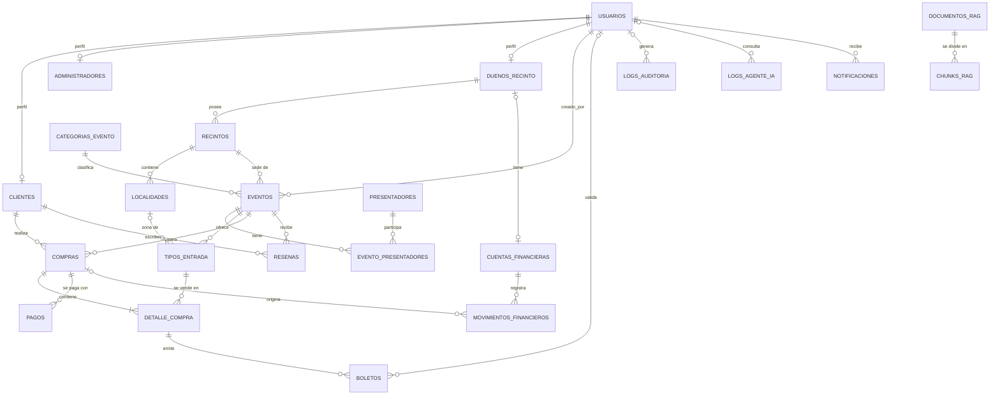

# Base de datos — Promotora de Eventos (v2)

Motor: **PostgreSQL 16** con extensión **pgvector**. Migraciones: **Flyway** (`database/migrations/V*.sql`).

Este documento explica el modelo **objetivo (v2)**: el script original más las correcciones de la revisión. Es la referencia que deben consultar las personas y los agentes de IA antes de escribir entidades, repositorios o SQL.

**Leyenda**

| Marca | Significado |
|---|---|
| ✅ | Existe tal cual en el script original (v1) |
| 🔧 | Existe en v1 y cambia en v2 |
| ➕ | Tabla o columna nueva en v2 |
| ➕* | Ajuste menor añadido para completar el diseño (no estaba en la revisión original; confírmalo) |

> El script con `DROP TABLE` de v1 es solo para desarrollo. En v2 el esquema se construye con migraciones Flyway; **nunca se ejecutan `DROP` contra una BD con datos**.

---

## 1. Visión general

25 tablas agrupadas por módulo (coinciden con los módulos de código):

| Módulo | Tablas | Propósito |
|---|---|---|
| Identity | `usuarios`, `clientes`, `administradores`, `duenos_recinto` | Cuentas, roles y perfiles |
| Venues | `recintos`, `localidades` | Lugares físicos y sus zonas (mapa) |
| Catalog | `categorias_evento`, `presentadores`, `eventos`, `evento_presentadores`, `tipos_entrada` | Qué se vende y a qué precio/cupo |
| Ticketing | `compras`, `detalle_compra`, `boletos` | Venta y emisión de boletos |
| Finance | `pagos`, `cuentas_financieras`, `movimientos_financieros` | Dinero: cobros, cuentas y ledger |
| Reviews | `resenas` | Opiniones de clientes |
| AI | `documentos_rag`, `chunks_rag`, `logs_agente_ia` | RAG y trazabilidad del agente |
| Audit / Messaging | `logs_auditoria`, `notificaciones`, `outbox_mensajes`, `mensajes_procesados` | Auditoría y mensajería confiable |
| BI | esquema `bi` (vistas) | Reportería y Power BI |

### Ajustes menores añadidos (➕*) — confirmar
1. `activo BOOLEAN NOT NULL DEFAULT true` en `recintos`, `localidades`, `presentadores`, `categorias_evento`, `tipos_entrada` (permite "eliminar" sin borrar historia).
2. Estado `EXPIRADA` en `compras` (distingue "no pagó a tiempo" de "cancelada por el usuario").
3. `compras.evento_id` (una compra = un evento; simplifica finanzas y reportes).
4. `documentos_rag.estado` y `subido_por`; `outbox_mensajes.fecha_publicado` e `intentos`.
5. `pagos.metodo` y `movimientos_financieros.descripcion`.

---

## 2. Diagrama entidad-relación



`outbox_mensajes` y `mensajes_procesados` no tienen FK: son infraestructura de mensajería referenciada por valor (`agregado`, `agregado_id`, `mensaje_id`).

---

## 3. Convenciones globales (🔧 respecto a v1)

| Tema | Regla v2 |
|---|---|
| Fechas | **`TIMESTAMPTZ`** en todas las columnas de fecha/hora (v1 usaba `TIMESTAMP`). El código trabaja en UTC |
| Claves | `GENERATED ALWAYS AS IDENTITY` en lugar de `SERIAL`. Tablas de alto volumen: `BIGINT` |
| IDs públicos | `compras` y `boletos` tienen `public_id UUID` (`gen_random_uuid()`, `UNIQUE`). La API **nunca** expone el ID entero de estas tablas (evita enumeración) |
| Nombres | `snake_case`, español, plural en tablas |
| Borrado | Datos transaccionales y financieros: **nunca `DELETE`**, solo cambio de estado. Catálogos: baja lógica con `activo = false` |
| FK | `ON DELETE RESTRICT` por defecto. `CASCADE` solo en relaciones de pertenencia pura (perfil→usuario, chunk→documento, reseña→evento) |
| Dinero | `NUMERIC(10,2)` en compras/detalle/pagos; `NUMERIC(12,2)` en cuentas/movimientos. Moneda por defecto **GTQ** |
| Estados | `VARCHAR` + `CHECK` (no ENUM nativo) para poder cambiarlos con migraciones simples |
| Rol único | Cada usuario tiene **un** rol (`usuarios.rol`) y exactamente una fila en la tabla de perfil correspondiente. Invariante validada en la aplicación (y con trigger opcional). Si algún día un usuario necesita varios roles, se migra a `usuarios_roles` |

---

## 4. Diccionario de datos

### 4.1 Identity

#### `usuarios` 🔧
Cuenta de acceso de cualquier persona. Es el discriminador de rol.

| Columna | Tipo | Restricciones / notas |
|---|---|---|
| id | INT identity | PK |
| email | VARCHAR(150) | NOT NULL, UNIQUE (normalizar a minúsculas) |
| password_hash | VARCHAR(255) | NOT NULL — hash con sal (Argon2/BCrypt/PBKDF2) |
| nombre, apellido | VARCHAR(100) | NOT NULL |
| rol | VARCHAR(20) | CHECK ∈ `CLIENTE`, `ADMINISTRADOR`, `DUENO_RECINTO` |
| estado | VARCHAR(20) | DEFAULT `ACTIVO`; CHECK ∈ `ACTIVO`, `INACTIVO`, `SUSPENDIDO` |
| fecha_registro | TIMESTAMPTZ | DEFAULT now() |

#### `clientes` ✅ · `administradores` ✅ · `duenos_recinto` ✅
Perfiles 1:1 con `usuarios` (`usuario_id` UNIQUE, `ON DELETE CASCADE`).

| Tabla | Columnas propias |
|---|---|
| clientes | `fecha_nacimiento DATE`, `telefono VARCHAR(20)` |
| administradores | `nivel_acceso` ∈ `ESTANDAR`, `SUPERADMIN` (DEFAULT `ESTANDAR`) |
| duenos_recinto | `empresa VARCHAR(150) NOT NULL`, `nit VARCHAR(20)` |

---

### 4.2 Venues

#### `recintos` 🔧
Lugar físico (estadio, iglesia, parque...).

| Columna | Tipo | Notas |
|---|---|---|
| id | INT | PK |
| dueno_id | INT | FK `duenos_recinto` — `RESTRICT` |
| nombre | VARCHAR(150) | NOT NULL |
| direccion, ciudad | VARCHAR | opcionales |
| latitud, longitud | NUMERIC(9,6) | opcionales |
| imagen_plano_url | VARCHAR(255) | imagen base del mapa |
| capacidad_total | INT | CHECK > 0 |
| activo ➕* | BOOLEAN | DEFAULT true |
| fecha_creacion | TIMESTAMPTZ | DEFAULT now() |

#### `localidades` 🔧
Zonas de un recinto (Palco, General, Gradas Norte...). Base del **mapa interactivo**.

| Columna | Tipo | Notas |
|---|---|---|
| id | INT | PK |
| recinto_id | INT | FK `recintos` — `CASCADE`; UNIQUE (`recinto_id`, `nombre`) |
| nombre | VARCHAR(100) | NOT NULL |
| capacidad | INT | CHECK > 0 |
| **geometria** ➕ | JSONB | Forma clicable sobre el plano. Ej.: `{"type":"polygon","points":[[10,20],[80,20],[80,60],[10,60]]}`. Coordenadas relativas al tamaño de `imagen_plano_url` |
| **color** ➕ | VARCHAR(7) | `#RRGGBB` para pintar la zona |
| activo ➕* | BOOLEAN | DEFAULT true |

El frontend dibuja el plano y superpone las geometrías; al hacer clic en una zona consulta los `tipos_entrada` con `localidad_id` = esa zona.

---

### 4.3 Catalog

#### `categorias_evento` ✅
Catálogo semilla: Concierto, Partido, Vigilia, Culto, Carrera, Meet & Greet. `nombre` UNIQUE. (+ `activo` ➕*)

#### `presentadores` ✅
Artistas, equipos, presentadores u organizaciones recurrentes. `tipo` ∈ `ARTISTA`, `EQUIPO`, `PRESENTADOR`, `ORGANIZACION`. Campos: `nombre`, `biografia`, `imagen_url` (+ `activo` ➕*).

#### `eventos` 🔧

| Columna | Tipo | Notas |
|---|---|---|
| id | INT | PK |
| recinto_id | INT | FK — `RESTRICT` |
| categoria_id | INT | FK — `RESTRICT` |
| ~~presentador_id~~ | — | 🔧 **Se elimina**: lo reemplaza `evento_presentadores` (un evento puede tener varios) |
| **creado_por** ➕ | INT | FK `usuarios` — quién creó el evento (admin o dueño) |
| nombre | VARCHAR(150) | NOT NULL |
| descripcion | TEXT | |
| fecha_inicio | TIMESTAMPTZ | NOT NULL |
| fecha_fin | TIMESTAMPTZ | CHECK `fecha_fin IS NULL OR fecha_fin >= fecha_inicio` |
| **fecha_inicio_venta**, **fecha_fin_venta** ➕ | TIMESTAMPTZ | Ventana de venta; CHECK de orden |
| **max_boletos_por_compra** ➕ | INT | DEFAULT 10, CHECK > 0 |
| estado | VARCHAR(20) | DEFAULT `BORRADOR` 🔧; ver §5 |
| imagen_url | VARCHAR(255) | |
| fecha_creacion | TIMESTAMPTZ | |

#### `evento_presentadores` ➕
Relación N:M evento–presentador. PK (`evento_id`, `presentador_id`); `evento_id` `CASCADE`, `presentador_id` `RESTRICT`; `rol VARCHAR(30)` (HEADLINER, INVITADO, LOCAL, VISITANTE...).
Permite que un festival tenga varios artistas y que las **reseñas se agreguen por presentador** (`resenas → eventos → evento_presentadores → presentadores`).

#### `tipos_entrada` 🔧
Lo que realmente se vende. Una sola tabla cubre tres casos:

| Caso | Cómo se modela |
|---|---|
| Entrada general | `localidad_id = NULL`, nombre "General" |
| Venta por localidad | `localidad_id` apunta a la zona; precio y cupo propios |
| Carrera | Una fila por distancia: "5K", "10K", "21K", "42K" (sin localidad) |

| Columna | Tipo | Notas |
|---|---|---|
| id | INT | PK |
| evento_id | INT | FK — `CASCADE` |
| localidad_id | INT NULL | FK `localidades` — 🔧 **`RESTRICT`** (v1: `SET NULL`, que convertía zonas en "general" sin avisar) |
| nombre | VARCHAR(100) | NOT NULL |
| precio | NUMERIC(10,2) | CHECK ≥ 0 |
| cupo_total | INT | CHECK ≥ 0 |
| cupo_disponible | INT | CHECK ≥ 0 y `cupo_disponible <= cupo_total` |
| activo ➕* | BOOLEAN | DEFAULT true |

**`cupo_disponible` solo se modifica con `UPDATE` atómico** (ver §7.1). Es el punto crítico anti-sobreventa.

---

### 4.4 Ticketing

#### `compras` 🔧
Cabecera de una orden. Nunca se borra.

| Columna | Tipo | Notas |
|---|---|---|
| id | INT | PK interno |
| **public_id** ➕ | UUID | UNIQUE; es el ID que ve la API |
| cliente_id | INT | FK `clientes` — `RESTRICT` |
| **evento_id** ➕* | INT | FK `eventos` — una compra = un evento |
| fecha_compra | TIMESTAMPTZ | DEFAULT now() |
| estado | VARCHAR(20) | DEFAULT `PENDIENTE`; ∈ `PENDIENTE`, `PROCESANDO`, `COMPLETADA`, `CANCELADA`, `FALLIDA`, `EXPIRADA`➕* |
| **expira_en** ➕ | TIMESTAMPTZ | Hasta cuándo se mantiene la reserva sin pago |
| **idempotency_key** ➕ | VARCHAR(100) | UNIQUE — un reintento no duplica la compra |
| **moneda** ➕ | CHAR(3) | DEFAULT `GTQ` |
| **subtotal**, **impuestos**, **comision_plataforma** ➕ | NUMERIC(10,2) | DEFAULT 0, ≥ 0 (regla de quién asume IVA/comisión: decisión D-11) |
| total | NUMERIC(10,2) | CHECK ≥ 0; `total = subtotal + impuestos + comision_plataforma` |
| ~~metodo_pago~~, ~~referencia_pago~~ | — | 🔧 **Se mueven a `pagos`** |

#### `detalle_compra` 🔧
Líneas de la compra: (tipo de entrada, cantidad, precio). `precio_unitario` es una **copia congelada** del precio al comprar.

| Columna | Notas |
|---|---|
| compra_id | FK `compras` — 🔧 `RESTRICT` (v1: CASCADE) |
| tipo_entrada_id | FK — `RESTRICT` |
| cantidad | CHECK > 0 |
| precio_unitario, subtotal | CHECK ≥ 0 y 🔧 **`subtotal = cantidad * precio_unitario`** |

Regla: `tipos_entrada.evento_id` debe ser igual a `compras.evento_id` (trigger/aplicación).

#### `boletos` 🔧
Un boleto = una persona = un QR. Se **generan** al completarse la compra (una fila por unidad de `cantidad`).

| Columna | Tipo | Notas |
|---|---|---|
| id | BIGINT | PK interno |
| **public_id** ➕ | UUID | UNIQUE |
| detalle_compra_id | INT | FK — 🔧 `RESTRICT` |
| codigo_qr | VARCHAR(100) | UNIQUE — 🔧 **token firmado HMAC-SHA256** (no adivinable) |
| estado | VARCHAR(20) | DEFAULT `VALIDO`; ∈ `VALIDO`, `USADO`, `ANULADO` |
| **nombre_asistente**, **documento_identidad** ➕ | VARCHAR | Obligatorios en carreras; opcionales en el resto según evento |
| **datos_extra** ➕ | JSONB | Ej. talla de camiseta, contacto de emergencia, tipo de sangre |
| fecha_emision | TIMESTAMPTZ | |
| **fecha_uso** ➕ | TIMESTAMPTZ | Cuándo se validó en la puerta |
| **validado_por** ➕ | INT | FK `usuarios` |

---

### 4.5 Finance

#### `pagos` ➕
Intentos de cobro de una compra (una compra puede tener varios si el primero falla).

| Columna | Notas |
|---|---|
| id BIGINT, compra_id (FK `RESTRICT`) | |
| pasarela VARCHAR(30) | Ej. `SIMULADA` |
| metodo ➕* VARCHAR(30) | `TARJETA`, `TRANSFERENCIA`... (antes `compras.metodo_pago`) |
| referencia VARCHAR(100) | Antes `compras.referencia_pago` |
| monto NUMERIC(10,2) | |
| estado | ∈ `PENDIENTE`, `APROBADO`, `RECHAZADO`, `REEMBOLSADO` |
| respuesta JSONB | Respuesta cruda de la pasarela (sin datos de tarjeta) |
| fecha TIMESTAMPTZ | |

#### `cuentas_financieras` ➕
Dónde "vive" el dinero. Una cuenta `PLATAFORMA` (comisiones) y una `DUENO` por cada dueño de recinto (ventas).

| Columna | Notas |
|---|---|
| tipo | ∈ `PLATAFORMA`, `DUENO` |
| dueno_id | FK `duenos_recinto`, NULL si es PLATAFORMA. CHECK `(tipo='DUENO') = (dueno_id IS NOT NULL)`; UNIQUE (`dueno_id`, `moneda`) |
| moneda CHAR(3) | DEFAULT `GTQ` |
| saldo NUMERIC(12,2) | Siempre igual a `SUM(movimientos_financieros.monto)` de esa cuenta |

#### `movimientos_financieros` ➕ (ledger inmutable)
Cada cambio de dinero es una fila. **Solo `INSERT`** (se revoca `UPDATE`/`DELETE`).

| Columna | Notas |
|---|---|
| cuenta_id | FK `cuentas_financieras` |
| compra_id | FK `compras`, NULL en liquidaciones manuales |
| tipo | ∈ `VENTA`, `COMISION`, `LIQUIDACION`, `REEMBOLSO` |
| monto NUMERIC(12,2) | **Con signo**: positivo suma al saldo, negativo resta. CHECK ≠ 0 |
| descripcion ➕* | texto libre |
| fecha | TIMESTAMPTZ |

| Evento de negocio | Movimientos |
|---|---|
| Compra completada | `VENTA` +subtotal en cuenta del dueño · `COMISION` +comision_plataforma en cuenta PLATAFORMA |
| Reembolso | `REEMBOLSO` negativo en la(s) misma(s) cuenta(s) |
| Liquidación al dueño | `LIQUIDACION` negativo en la cuenta del dueño (retiro) |

---

### 4.6 Reviews

#### `resenas` ✅
`calificacion` 1–5, `comentario`, `estado` ∈ `PENDIENTE`, `APROBADA`, `RECHAZADA`. UNIQUE (`evento_id`, `cliente_id`).
Reglas de aplicación: solo clientes con boleto `USADO` del evento; moderación por ADMINISTRADOR; el promedio por presentador sale de `resenas APROBADA → evento_presentadores`.

---

### 4.7 AI (RAG y agente)

#### `documentos_rag` 🔧
Documentos del negocio ingestados (reglamentos, políticas de reembolso, FAQ, guías de recinto).
Columnas: `titulo`, `tipo_documento`, `contenido` (texto extraído), `ruta_archivo`, `version`, `fecha_carga` (TIMESTAMPTZ), `estado` ➕* ∈ `PENDIENTE`, `INDEXADO`, `ERROR`, `INACTIVO`, `subido_por` ➕* (FK `usuarios`).
Solo los `INDEXADO` participan en la recuperación.

#### `chunks_rag` ➕
Fragmentos de cada documento con su vector.

| Columna | Notas |
|---|---|
| documento_id | FK `documentos_rag` — `CASCADE` |
| orden INT, pagina INT | Para citar "documento X, página Y" |
| contenido TEXT | El fragmento |
| embedding `vector(1536)` | Dimensión del modelo `text-embedding-3-small` de OpenAI. **Si cambia el modelo, hay que reindexar** |
| metadata JSONB | Sección, idioma, etc. |

Índice: `USING hnsw (embedding vector_cosine_ops)`.

#### `logs_agente_ia` 🔧
Bitácora de cada consulta al agente.
Columnas v1: `usuario_id` (NULL si anónimo), `consulta`, `respuesta`, `fuentes_citadas JSONB`, `tiempo_respuesta_ms`, `fecha_hora`.
Nuevas ➕: `session_id UUID`, `modelo VARCHAR`, `tokens_entrada INT`, `tokens_salida INT`, `estado` ∈ `OK`, `SIN_CONTEXTO`, `ERROR`, `RECHAZADA`.

---

### 4.8 Audit y mensajería

#### `logs_auditoria` 🔧
Quién hizo qué. `BIGINT`, solo `INSERT` (se revoca `UPDATE`/`DELETE` al rol de la aplicación).
Columnas: `usuario_id` (SET NULL), `entidad_afectada`, **`entidad_id` ➕ VARCHAR(50)**, `accion`, `detalle JSONB`, `ip_origen`, `fecha_hora`.
`accion` 🔧 ampliada: `CREATE`, `UPDATE`, `DELETE`, `LOGIN`, `LOGOUT`, `LOGIN_FAILED`, `PURCHASE`, `PAYMENT`, `REFUND`, `VALIDATE`, `MODERATE`, `EXPORT`, `INGEST`.
Índices: `usuario_id`, (`entidad_afectada`, `entidad_id`), `fecha_hora`.

#### `notificaciones` ✅
Evidencia de que el flujo asíncrono corrió (correos de confirmación, bienvenida). `tipo`, `estado` ∈ `PENDIENTE`, `ENVIADO`, `FALLIDO`, `mensaje`, `fecha_creacion`, `fecha_envio`. Índices por `estado` y 🔧 `usuario_id`.

#### `outbox_mensajes` ➕
Patrón **Outbox**: el mensaje se guarda en la misma transacción que el cambio de negocio y un proceso lo publica después a RabbitMQ.
Columnas: `agregado`, `agregado_id`, `tipo`, `payload JSONB`, `publicado BOOLEAN`, `fecha`, `fecha_publicado` ➕*, `intentos` ➕*.
Índice parcial: `WHERE publicado = false`.

#### `mensajes_procesados` ➕
Idempotencia del consumidor: PK `mensaje_id`, `consumidor`, `fecha`. Si el insert falla por duplicado, el mensaje ya se procesó.

---

## 5. Máquinas de estado

```
eventos:   BORRADOR → PROGRAMADO → EN_VENTA ⇄ AGOTADO → FINALIZADO
              └──────────────┴──────────┴────────► CANCELADO

compras:   PENDIENTE → PROCESANDO → COMPLETADA
               │            └──────► FALLIDA
               ├──────────────────► EXPIRADA   (venció expira_en)
               └──────────────────► CANCELADA  (por el usuario/admin)

boletos:   VALIDO → USADO          VALIDO → ANULADO (reembolso/cancelación)

pagos:     PENDIENTE → APROBADO → REEMBOLSADO
                  └──► RECHAZADO

resenas:   PENDIENTE → APROBADA | RECHAZADA
documentos_rag: PENDIENTE → INDEXADO | ERROR      INDEXADO → INACTIVO
```
Al pasar una compra a `FALLIDA`, `EXPIRADA` o `CANCELADA` se **devuelve el cupo** una sola vez.

---

## 6. Reglas de integridad que el esquema por sí solo no garantiza

Se implementan con **triggers en PostgreSQL** (red de seguridad) y se validan también en la capa de aplicación:

| # | Regla |
|---|---|
| 1 | La localidad de un `tipo_entrada` pertenece al mismo recinto que el evento |
| 2 | Por evento, la suma de `cupo_total` de los tipos de una localidad ≤ `localidades.capacidad` |
| 3 | La suma de `localidades.capacidad` de un recinto ≤ `recintos.capacidad_total` |
| 4 | Los `tipos_entrada` de un `detalle_compra` son del mismo evento que `compras.evento_id` |
| 5 | Un usuario tiene exactamente una fila de perfil acorde a su `rol` |
| 6 | `movimientos_financieros` y `logs_*` no admiten `UPDATE` ni `DELETE` |
| 7 | `cuentas_financieras.saldo` = suma de sus movimientos (verificado por prueba y por reporte de conciliación) |

---

## 7. Flujos de datos clave

### 7.1 Reserva atómica de cupo (anti-sobreventa)
```sql
UPDATE tipos_entrada
   SET cupo_disponible = cupo_disponible - :n
 WHERE id = :id AND cupo_disponible >= :n;
-- 0 filas afectadas => agotado (HTTP 409)
```
Se ejecuta dentro de la misma transacción que crea la compra y el registro de outbox.

### 7.2 Compra de alta demanda
1. `INSERT compras` (`PENDIENTE`, `expira_en`, `idempotency_key`) + `INSERT detalle_compra` + reserva atómica + `INSERT outbox_mensajes` → **commit**.
2. Relay publica `compra.procesar` y marca `publicado = true`.
3. Consumidor (idempotente vía `mensajes_procesados`): `INSERT pagos` → si aprobado: `INSERT boletos`, `INSERT movimientos_financieros`, actualizar saldos, compra `COMPLETADA`, outbox `compra.completada`.
4. Si rechazado/error: compra `FALLIDA` y devolución de cupo.
5. Consumidor de notificación: envía correo y `INSERT notificaciones`.

### 7.3 Expiración
Job periódico: `compras` en `PENDIENTE` con `expira_en < now()` → `EXPIRADA` + devolución de cupo, todo en una transacción, con bloqueo (`FOR UPDATE SKIP LOCKED`) para que dos workers no devuelvan dos veces.

### 7.4 Validación en puerta
```sql
UPDATE boletos SET estado='USADO', fecha_uso=now(), validado_por=:u
 WHERE codigo_qr=:c AND estado='VALIDO';
-- 0 filas => ya usado, anulado o inexistente
```

### 7.5 Ingesta y consulta RAG
Ingesta: archivo → texto → `documentos_rag` (`PENDIENTE`) → chunks + embeddings → `chunks_rag` → documento `INDEXADO`.
Consulta: embedding de la pregunta → `ORDER BY embedding <=> :q LIMIT k` (solo documentos `INDEXADO`) → LLM → respuesta con fuentes → `INSERT logs_agente_ia`.

---

## 8. Índices

Los de v1 se conservan. Nuevos recomendados:

`eventos(estado)` · `eventos(categoria_id)` · `eventos(creado_por)` · `compras(estado)` · `compras(evento_id)` · `compras(expira_en) WHERE estado='PENDIENTE'` · `boletos(estado)` · `boletos(public_id)` · `tipos_entrada(localidad_id)` · `notificaciones(usuario_id)` · `logs_auditoria(usuario_id)` · `logs_auditoria(entidad_afectada, entidad_id)` · `movimientos_financieros(cuenta_id, fecha)` · `pagos(compra_id)` · `outbox_mensajes(id) WHERE publicado=false` · HNSW sobre `chunks_rag.embedding`.

---

## 9. Seguridad a nivel de base de datos

| Rol PostgreSQL | Permisos |
|---|---|
| `flyway` | DDL (solo para migraciones) |
| `promotora_app` | DML sobre tablas operativas. **Sin** `UPDATE`/`DELETE` en `movimientos_financieros`, `logs_auditoria`, `logs_agente_ia` |
| `bi_reader` | Solo `SELECT` sobre el esquema `bi`. Sin acceso a tablas operativas |

---

## 10. Esquema `bi` y los 15 reportes

Cada reporte se apoya en una vista; la API de reportes y Power BI leen las mismas vistas.

| # | Reporte | Vista `bi.*` | Tablas principales |
|---|---|---|---|
| R-01 | Ventas por evento | `vw_ventas_por_evento` | compras, detalle_compra, eventos |
| R-02 | Ventas por categoría | `vw_ventas_por_categoria` | + categorias_evento |
| R-03 | Ventas por recinto | `vw_ventas_por_recinto` | + recintos |
| R-04 | Ventas por fecha y método de pago | `vw_ventas_diarias` | compras, pagos |
| R-05 | Ocupación por localidad | `vw_ocupacion_localidad` | tipos_entrada, localidades |
| R-06 | Boletos vendidos vs. usados | `vw_asistencia_evento` | boletos, detalle_compra |
| R-07 | Ingresos por dueño de recinto | `vw_ingresos_dueno` | movimientos_financieros, cuentas_financieras |
| R-08 | Comisiones de la plataforma | `vw_comisiones_plataforma` | movimientos_financieros |
| R-09 | Top clientes | `vw_top_clientes` | compras, clientes, usuarios |
| R-10 | Compras fallidas/canceladas/expiradas | `vw_compras_no_exitosas` | compras, pagos |
| R-11 | Calificación promedio por presentador | `vw_calificacion_presentador` | resenas, evento_presentadores |
| R-12 | Eventos por estado | `vw_eventos_por_estado` | eventos |
| R-13 | Inscritos por distancia en carreras | `vw_inscritos_carreras` | tipos_entrada, boletos, eventos |
| R-14 | Uso del agente de IA | `vw_uso_agente_ia` | logs_agente_ia |
| R-15 | Auditoría y notificaciones por estado | `vw_auditoria_operaciones`, `vw_notificaciones_estado` | logs_auditoria, notificaciones |

---

## 11. Matriz CRUD (entidades núcleo)

El requisito pide CRUD completo en 12–15 entidades núcleo. Para datos que no se pueden borrar, la **D** del CRUD se implementa como **baja lógica o cambio de estado** (y así se documenta en el Manual Técnico).

| # | Entidad | C | R | U | D (cómo) |
|---|---|:-:|:-:|:-:|---|
| 1 | usuarios (+ perfiles cliente/admin/dueño) | ✔ | ✔ | ✔ | `estado = INACTIVO` |
| 2 | recintos | ✔ | ✔ | ✔ | `activo = false` |
| 3 | localidades (+ geometría) | ✔ | ✔ | ✔ | `activo = false` |
| 4 | categorias_evento | ✔ | ✔ | ✔ | `activo = false` |
| 5 | presentadores | ✔ | ✔ | ✔ | `activo = false` |
| 6 | eventos | ✔ | ✔ | ✔ | `estado = CANCELADO` |
| 7 | evento_presentadores | ✔ | ✔ | ✔ | `DELETE` físico (sin historia propia) |
| 8 | tipos_entrada | ✔ | ✔ | ✔ | `activo = false` |
| 9 | compras | ✔ | ✔ | ✔ (estado) | `estado = CANCELADA` |
| 10 | boletos | ✔ (emisión) | ✔ | ✔ (validar/datos) | `estado = ANULADO` |
| 11 | resenas | ✔ | ✔ | ✔ | `estado = RECHAZADA` / el autor la retira |
| 12 | pagos | ✔ | ✔ | ✔ (estado) | `estado = REEMBOLSADO` |
| 13 | cuentas_financieras | ✔ | ✔ | ✔ | cierre lógico |
| 14 | documentos_rag | ✔ | ✔ | ✔ (nueva versión) | `estado = INACTIVO` |
| 15 | movimientos_financieros | ✔ | ✔ | — | — (inmutable; ajuste = nuevo movimiento) |

Solo escritura / consulta (no cuentan como CRUD): `detalle_compra` (parte de compra), `chunks_rag`, `logs_auditoria`, `logs_agente_ia`, `notificaciones`, `outbox_mensajes`, `mensajes_procesados`.

---

## 12. Plan de migraciones Flyway

| Archivo | Contenido |
|---|---|
| `V1__identidad.sql` | `usuarios`, `clientes`, `administradores`, `duenos_recinto` |
| `V2__recintos.sql` | `recintos`, `localidades` (con geometría y color) |
| `V3__catalogo_eventos.sql` | `categorias_evento`, `presentadores`, `eventos`, `evento_presentadores`, `tipos_entrada` |
| `V4__ventas.sql` | `compras`, `detalle_compra`, `boletos` |
| `V5__finanzas.sql` | `pagos`, `cuentas_financieras`, `movimientos_financieros` |
| `V6__resenas.sql` | `resenas` |
| `V7__auditoria_ia_rag.sql` | `CREATE EXTENSION vector`, `documentos_rag`, `chunks_rag`, `logs_auditoria`, `logs_agente_ia` |
| `V8__mensajeria.sql` | `notificaciones`, `outbox_mensajes`, `mensajes_procesados` |
| `V9__indices_triggers_permisos.sql` | Índices, triggers de integridad (§6), roles y `REVOKE` |
| `V10__seed_catalogos.sql` | Categorías de evento, cuenta PLATAFORMA, admin inicial |
| `R__bi_vistas.sql` | Vistas `bi.*` (repetible), rol `bi_reader` |

Datos de prueba (eventos, recintos, compras de ejemplo) en `database/seed-dev/`, **fuera** de las migraciones de producción.

---

## 13. Decisiones abiertas que afectan a la BD

| ID | Tema | Por defecto en este documento |
|---|---|---|
| D-08 | ¿Asientos numerados? | No: solo localidades con cupo. Si se piden, nueva tabla `asientos` |
| D-11 | ¿Quién asume IVA y comisión? | La comisión se cobra al cliente como cargo por servicio; el IVA se muestra aparte |
| D-12 | Un rol por usuario | Sí (`usuarios.rol` + una fila de perfil) |
| D-07 | Refresh tokens | Si se aprueban: tabla `refresh_tokens` (usuario_id, hash, expira_en, revocado) → 26 tablas |
