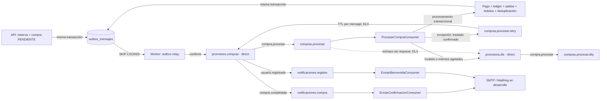

# Topología y entrega de mensajes — F6-10

## Flujo implementado

La topología se declara de forma idempotente en `RabbitMqTopology`. Exchanges direct y durables; colas durables, no exclusivas y sin auto-delete. El relay solo ve outboxes de transacciones confirmadas. Todos los publishers usan mensajes persistentes, ID estable, mandatory y publisher confirms.

| Exchange / ruta | Destino | Responsable |
|---|---|---|
| `promotora.compras` / `compra.procesar` | `compras.procesar` | ProcesarCompraConsumer |
| `promotora.compras` / `compra.completada` | `notificaciones.compra` | EnviarConfirmacionConsumer |
| `promotora.compras` / `usuario.registrado` | `notificaciones.registro` | EnviarBienvenidaConsumer |
| Exchange predeterminado / `compras.procesar.retry` | `compras.procesar.retry` | Broker: TTL y retorno por DLX |
| `promotora.dlx` / `compra.procesar` | `compras.procesar.dlq` | Revisión operativa; sin consumidor automático |

La cola principal tiene DLX `promotora.dlx`, ruta `compra.procesar`. Retry tiene DLX `promotora.compras`, misma ruta. No existe binding de retry desde el exchange de negocio: el consumidor publica a su nombre mediante el exchange predeterminado. No hay una cola de retry/DLQ adicional para notificaciones.

## Contratos y límites transaccionales

`MessageId` es `outbox_mensajes.id`; `Type` es la ruta y `ContentType=application/json`. Compras y confirmación llevan solo `{ "publicId": "UUID" }`. Bienvenida lleva `usuarioId`; el handler obtiene el destinatario actual de PostgreSQL. Los asistentes se conservan en el outbox de compra para la emisión, pero el relay los elimina del mensaje de RabbitMQ. Nunca incluir credenciales ni registrar cuerpos o códigos QR completos.

El relay bloquea una fila por transacción con `FOR UPDATE SKIP LOCKED`, publica y espera confirmación antes de marcarla publicada. Si el broker confirma y falla el commit, se republicará el mismo ID. El contador del relay registra intentos de publicación: no limita el número de entregas del consumidor ni envía a DLQ por sí mismo.

El consumidor usa ACK manual individual después del commit del procesamiento o de la confirmación del traslado a retry/DLQ. `(mensaje_id, consumidor)` se confirma junto con los efectos; una reentrega ya procesada omite el cobro. Si no puede confirmar el traslado, termina y dispone el canal sin ACK; Worker reconecta con espera cancelable de dos segundos. La entrega es al menos una vez.

En el adaptador simulado actual, toma PENDIENTE → PROCESANDO, pago, ledger, saldos, COMPLETADA, boletos, auditoría, deduplicación y outbox de confirmación están en una transacción. Una excepción la revierte, incluida la toma. Un rechazo de pago confirmado marca FALLIDA y devuelve cupo una sola vez. Nunca se publica a RabbitMQ dentro de esa transacción.

## Reintentos

| Clave Worker | Predeterminado | Validación |
|---|---:|---|
| `Compras:Prefetch` | 16 | 1–1000 |
| `Compras:MaxIntentos` | 3 | 1–10 |
| `Compras:RetryBaseDelayMilliseconds` | 5000 | 1–300000 ms |

Despacho de callbacks serial por canal (`ConsumerDispatchConcurrency=1`); prefetch limita entregas sin ACK y no significa que un canal ejecute ese número de cobros en paralelo. Para distribuir procesamiento se usan instancias consumidoras, manteniendo deduplicación transaccional.

Ante excepción se incrementa `x-intentos`; el TTL por mensaje es base × 2^(intento fallido − 1), acotado a 300000 ms. Con los valores predeterminados: primera ejecución fallida → retry 5 s; segunda → retry 10 s; tercera → DLQ con `x-intentos=3`. No es un máximo de tres reintentos adicionales. Un Result fallido o contrato inválido va directamente a DLQ. No hay reprocesamiento automático de DLQ; corregir la causa y definir la intervención antes de republicar. Un mensaje reenviado sin ajustar un header agotado volverá a DLQ.

Las notificaciones tienen prefetch 1 por canal, ACK después del commit y reintentos SMTP internos configurables. Al agotarlos se registra FALLIDO y se confirma; no usan las colas retry/DLQ de compras. SMTP y PostgreSQL no comparten commit: una caída tras aceptación SMTP puede repetir el correo. Detalle en [NOTIFICACIONES_CORREO.md](NOTIFICACIONES_CORREO.md).

## Verificar localmente

Configura y ejecuta API/Worker con los comandos separados de [COMPRAS_ASINCRONAS.md](COMPRAS_ASINCRONAS.md) y [MENSAJERIA_OUTBOX.md](MENSAJERIA_OUTBOX.md). `Outbox:Enabled`, `Compras:ConsumerEnabled` y `Notificaciones:Enabled` son opt-in; requieren sus conexiones, firma QR y configuración externa. Para correos usa MailHog según la guía de notificaciones. No hay credenciales nuevas en este PR.

En [RabbitMQ Management](http://localhost:15672), con tu usuario `promotora` y contraseña actual, revisa los dos exchanges y las cinco colas. En Swagger autenticado como CLIENTE crea una compra, consulta su Location hasta COMPLETADA y lista sus boletos. La respuesta 202 solo confirma la reserva; un publisher confirm solo confirma recepción del broker. Consulta el estado final de la compra para conocer el resultado del negocio.

Pruebas aisladas y evidencia:

- [PRUEBAS_F6_RESILIENCIA.md](PRUEBAS_F6_RESILIENCIA.md): duplicados, retry/DLQ y corte antes/después del commit.
- [PRUEBAS_F6_CARGA.md](PRUEBAS_F6_CARGA.md): 500/1000 solicitudes con cupo limitado y conciliación financiera.
- `OutboxTests` y `RabbitMqMessagingTests`: publicación, rollback, confirms y concurrencia del relay.

F6-11 sigue pendiente: consulta durable del pago simulado y recuperación de PROCESANDO persistidas. La pasarela actual conserva resultados solo en memoria; esta topología no permite concluir que un pago desconocido tras reinicio fue rechazado. Tampoco habilita sustituirla por una pasarela externa sin un protocolo de recuperación y conciliación.
